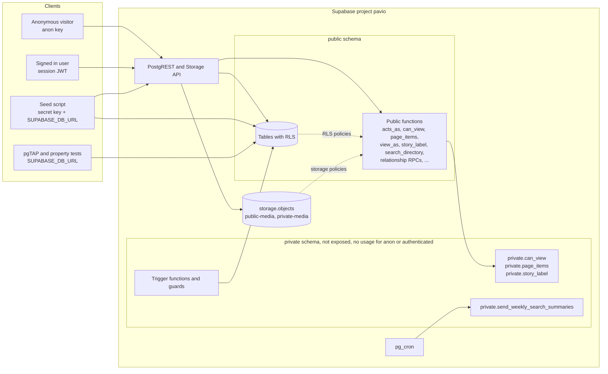
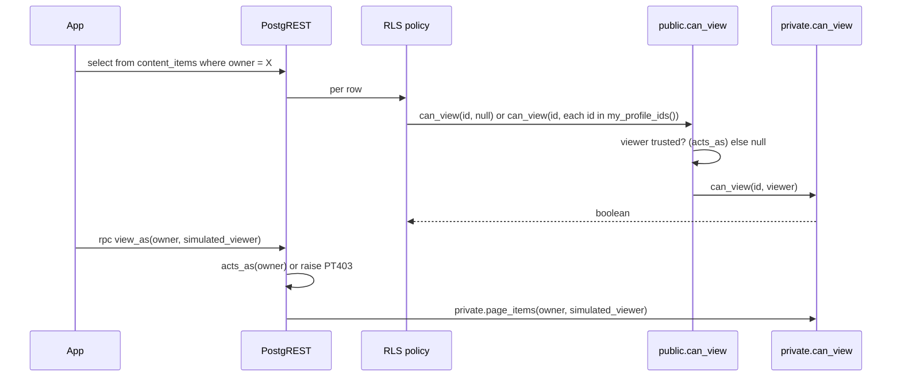

# Design Document: 00 Database Foundation

## Resolved decisions used in this design

Dominic's answers to the NQ questions are recorded in **Resolved Decisions** in `requirements.md`. This design applies them as follows.

| Question | Answer applied in this design | Sections affected |
|---|---|---|
| **NQ-1** Whose relationships decide a vouch's audience on the subject's page? | Always the Vouch_Author's. `private.can_view` treats the author as Owner of a vouch on every page. | can_view, page_items, Property 1, 2, 3 |
| **NQ-2** Do non public featured vouches count toward Search_Trust? | No. Only featured vouches with audience `public` count, and the **default vouch audience is `public`** (column default and `create_vouch` default). | `vouches`, `create_vouch`, `private.search_trust`, search_directory, Property 9, 21 |
| **NQ-3** Labels on stories not shared to circles | None. `story_label` returns no row for audience `public`, `connections` or `group`. | story_label, Property 11 |
| **NQ-4** Does hiding a vouch affect Search_Trust? | No. A Hidden_Vouch that is featured and public still counts. | `private.search_trust`, Property 21 |
| **NQ-5** Which files go in which bucket? | `public-media`: avatars, covers, images inside writing. `private-media`: every gallery and story file, whatever its audience, read through signed URLs. Enforced by path rules (`private.media_kind_allowed`) in the upload policies and by content details checks. | Storage buckets, content details checks |
| **NQ-6** Anonymous search appearance counting | Each anonymous search adds 1 per returned profile. Signed in searchers count once per searcher, profile and Nairobi_Day. | search_directory, search_appearance_marks, Property 20 |

### Design decisions

D-1 to D-8 are choices made while writing this design that go slightly beyond the requirement text. DR-1 to DR-4 are the design review changes recorded in `requirements.md`; D-8 states how DR-1 is implemented.

| Item | Choice | Why |
|---|---|---|
| **D-1** Extra functions for `anon` | Besides the three functions named in Req 22.4, `anon` may also execute `page_items`, `story_label`, `acts_as` and `try_uuid`. | Signed out page views list items through `page_items`; storage policies need `try_uuid`. Each one evaluates as a null viewer for `anon`. |
| **D-2** Story label with an empty linked circle | `only_for_you` whenever no linked circle holds anyone other than the viewer, so an empty linked circle does not change the label. | Makes Req 13.5 and 13.6 exact complements; nobody else can see the story through an empty circle. |
| **D-3** Audience silence | Viewers never receive an item's `audience` or a vouch's `hidden_by_subject`; only owners (and the subject, for hiding) read them through functions. | Seeing audience `circles` on a gallery photo would tell a viewer they are in one of the owner's circles. |
| **D-4** AI cost reporting | `ai_record_call` rejects a cost above `max_cost_per_call_usd` (default 0.05 US dollars). | The cost is reported by the AI_Route; the bound limits the damage of a bug to about 1 US dollar of the monthly cap per user per day. |
| **D-5** Vouch audiences | A vouch may use `public`, `connections` or `circles`, not `group`. | A vouch has no group to point at. |
| **D-6** Handles are never rewritten | The profiles trigger does not lowercase or trim `handle`. A handle with capitals or any other character outside `^[a-z][a-z0-9_]{2,29}$` is rejected by the format check (Req 4.3). Uniqueness is the unique index on `lower(handle)` (Req 4.2). The reserved word check compares the handle as given (Req 4.4 to 4.6). | The stored handle always equals what the user typed, so the page address never changes silently. Property 17. |
| **D-7** Removing the last circle link | Constraint trigger `item_circles_last_link` (after delete on `item_circles`, deferrable initially deferred) rejects at commit, with `PT422 'content.circles_required'`, a transaction that leaves a content item or vouch with audience `circles` and no circle link. It does not fire a rejection when the circle or the item itself was deleted in the same transaction; an item left without links because its circle was deleted is visible only to its owner. | Keeps Req 11.7 true after creation, not only when the audience is written. Deleting a circle must still work, and the leftover item fails closed, so nothing leaks. |
| **D-8** Canary and the private schema | `anon` and `authenticated` have no USAGE on schema `private`, and that stays true. No grant on schema `private` or any of its functions, and no public wrapper, is added for the canary. `asUser` sets `request.jwt.claims` with both `sub` and `role` through `set_config` with a bound parameter, reads `private.is_api_caller()` while still the test owner (before `set local role` runs) and captures the value. No public security definer wrapper of `is_api_caller` exists, so the pre-switch read is the only path. After the switch it asserts `current_user` = the expected role, `auth.uid()` = the given `sub` (null for `anon`) and the captured value = true. Any failure fails the case before the function under test runs. | `private.is_api_caller()` reads only `request.jwt.claims`, which does not change between the read and the function under test, so the captured value is what the policies see. Granting USAGE on `private` would expose every private function name to the API roles. See **Simulated users and the canary check**. |
| **DR-1** Canary check | The `asUser` helper always sets `sub` and `role`, then asserts `current_user`, `auth.uid()` and `private.is_api_caller()`, failing at once if any check fails. A pgTAP canary test and a property sanity test prove a known restricted row is invisible, so no test silently runs as a Trusted_Caller. | Req 25.12, 26.3, 26.20 to 26.23. Implemented as described in D-8. |
| **DR-2** AI usage recording | `public.ai_record_call` is executable by `service_role` only. The AI_Route checks `ai_can_call` as the signed in user and records usage through the Admin_Client. | Req 17.3, 17.4, 17.7 to 17.9, 22.11, 25.13. The browser can never report a cost. |
| **DR-3** Property test cost | Properties default to 25 runs against the remote Database, set through `PROPERTY_RUNS`. Before the pull request the suite runs once with `PROPERTY_RUNS=100`, and both run times go in `DEVLOG.md`. | Req 26.17, 26.24, 28.11. |
| **DR-4** Accepted definer RPC lints | Security advisor lints 0028 and 0029 (security definer functions executable through the API) are accepted only for the public security definer functions listed in **Function execute grants** below (the `anon` row and the `authenticated` row). After the final migration the security advisor reports no finding other than 0028 or 0029 on exactly that allowlist. `02_security_definer.test.sql` pins the allowlist: the set of public security definer functions executable by `anon`, and the set executable by `authenticated`, must each equal it exactly. Any other security finding is still fixed in a `fix_` migration. | Req 22.3, 22.9. |

## Overview

Spec 00 builds the whole Pavio database on the hosted Supabase project `pavio`, before any interface exists. It delivers:

1. Every table for every Pavio feature, including stretch tables (groups, chat) that stay empty.
2. The privacy engine: `acts_as`, `can_view`, `page_items`, `view_as` and `story_label`. Visibility is decided in exactly one function body, `private.can_view`.
3. Row Level Security on every table, explicit column and table grants, and storage bucket policies.
4. Public directory search with typo tolerance, ranked by text relevance and Search_Trust.
5. Signals: notifications from triggers, profile views with daily deduplication, search appearances and a weekly `pg_cron` summary.
6. pgTAP tests, fast-check property tests against the real database, and an idempotent demo seed.

No user interface is built. The only Node code is test tooling and the seed script.

### Main design decisions

| Decision | Choice | Why |
|---|---|---|
| Vouch storage | Own table `vouches`, sharing the uuid id space with `content_items`; `can_view(item_id, …)` resolves either | Vouches have two parties with different write rights (author edits, subject hides) and a deferrable Top 8 constraint. Forcing these into `content_items` would put vouch-only columns and column rules on every item. Recorded in `docs/decisions/001-vouches-own-table.md`. |
| One visibility function | All logic in `private.can_view(item, viewer)`. `public.can_view` only replaces an untrusted viewer id with null and calls it. | Lets `view_as` simulate any viewer while the API cannot impersonate one. The rule exists once. Recorded in `docs/decisions/002-can-view-core-and-wrapper.md`. |
| Private profile fields | Kept in `profiles`, hidden with column level SELECT grants; read through `my_profiles()` | Requirement 4.1 places them in `profiles`; column grants keep them from `anon` and other users. |
| Relationship access | No direct table access. All reads and writes go through security definer RPCs; structural guards live in table triggers. | Requirement 8.19 needs a declined request to read as `pending` to its requester. Row security cannot rewrite a value, so the table itself must not be readable. Recorded in `docs/decisions/003-relationships-through-rpc.md`. |
| Circle private name | `circles` is readable only when `acts_as(owner_profile_id)`; no other table, view or function returns `private_name` | Row level denial covers every column. The member label leaves the table only through `story_label`. |
| Audience silence | `audience` and `hidden_by_subject` are excluded from SELECT grants; owners read them through `item_audience()` and `my_received_vouches()` | Seeing that a gallery photo has audience `circles` would tell a viewer they are in one of the owner's circles. |
| Search language config | `simple` text search config | Pavio is English and Swahili; English stemming would mangle Swahili words. |
| Atomic creation of circle items | RPCs `create_content_item`, `create_vouch`, `set_item_audience` | PostgREST runs one statement per request. Creating an item and its circle links in two requests would briefly expose a circle item as `connections`. |

## Architecture



### Trust model

- `anon` and `authenticated` reach the database only through PostgREST and the Storage API. They see the `public` schema only, subject to grants and RLS.
- The `private` schema is not in the API's exposed schemas, and `anon` and `authenticated` get no `usage` on it. Sensitive private functions also have `execute` revoked from `public`.
- Every security definer function sets `search_path = ''` and uses fully qualified names.
- A caller is an **API caller** when `auth.jwt() ->> 'role'` is `anon` or `authenticated` (helper `private.is_api_caller()`). Acting rules in triggers apply only to API callers; structural rules (shape, self relation, business to person) apply to everyone, including the seed and tests run as `postgres`.
- The viewer id passed to any public visibility function is trusted only if the caller acts as it. Otherwise it becomes null (signed out).

### Acting as

A Signed_In_User controls their Person_Profile (through `profiles.owner_user_id`) and every Business_Profile where they hold a row in `profile_managers`. `public.acts_as(profile_id)` answers "does the current login control this profile". Every write policy checks `acts_as` on the profile recorded on the row, never only `auth.uid()`.

`private.share_controller(a, b)` answers "is there any login that controls both profiles". It blocks relating to, vouching for, or viewing a page you manage, and it works for the seed too, where `auth.uid()` is null.

### Request flows



## Components and Interfaces

All functions are listed with signature, language, security, `search_path`, volatility and logic in SQL-like pseudocode. "Definer" means `security definer set search_path = ''`. Error codes are listed in **Error Handling**.

### Helper functions (private, not callable by the API)

| Function | Returns | Lang / security / volatility | Logic |
|---|---|---|---|
| `private.is_api_caller()` | boolean | sql, invoker, stable | `coalesce(auth.jwt() ->> 'role', '') in ('anon','authenticated')` |
| `private.nairobi_today()` | date | sql, invoker, stable | `(now() at time zone 'Africa/Nairobi')::date` |
| `private.nairobi_month_start()` | date | sql, invoker, stable | `date_trunc('month', now() at time zone 'Africa/Nairobi')::date` |
| `private.controls(p_user uuid, p_profile uuid)` | boolean | sql, definer, stable | `exists(profiles where id = p_profile and owner_user_id = p_user) or exists(profile_managers where profile_id = p_profile and user_id = p_user)` |
| `private.share_controller(a uuid, b uuid)` | boolean | sql, definer, stable | `exists(select u from controllers(a) intersect select u from controllers(b))`, where controllers(p) = `owner_user_id of p` ∪ `user_id from profile_managers where profile_id = p` |
| `private.is_connected(a uuid, b uuid)` | boolean | sql, definer, stable | `exists(relationships where least(requester,target) = least(a,b) and greatest(...) = greatest(a,b) and type = 'connection' and status = 'accepted')` (uses `relationships_pair_uq`) |
| `private.follows(p_person uuid, p_business uuid)` | boolean | sql, definer, stable | same pair lookup with `type = 'follow' and requester = p_person and target = p_business` |
| `private.in_audience(p_owner uuid, p_viewer uuid)` | boolean | sql, definer, stable | `is_connected(p_owner, p_viewer) or (owner is business and follows(p_viewer, p_owner))` |
| `private.in_circle(p_circle uuid, p_viewer uuid)` | boolean | sql, definer, stable | `c := circles[p_circle]; if c.is_all_followers then follows(p_viewer, c.owner) else exists(circle_members where circle_id = p_circle and member_profile_id = p_viewer)` |
| `private.tags_valid(text[])` | boolean | sql, invoker, immutable | `cardinality(t) <= 20 and every tag: length 1..40, tag = lower(btrim(tag))` |
| `private.immutable_array_to_text(text[])` | text | sql, invoker, immutable, `set search_path = ''` | `pg_catalog.array_to_string(t, ' ')` (wrapper so it can feed the generated columns `tags_text` and `search_tsv`; created in migration 2, before `profiles`) |
| `private.content_details_valid(content_type, jsonb)` | boolean | sql, invoker, immutable | see Content details shapes |
| `private.opening_hours_valid(jsonb)` | boolean | sql, invoker, immutable | object; keys ⊆ {mon..sun}; each value null or `{"open":"HH:MM","close":"HH:MM"}` matching `^([01]\d|2[0-3]):[0-5]\d$` |
| `private.search_trust(p_profile uuid)` | integer | sql, definer, stable | `count(*) from vouches where subject_profile_id = p_profile and top8_position is not null and audience = 'public'` (one vouch per author and subject, so this counts distinct authors; hidden vouches count, NQ-2, NQ-4) |

The pure validation helpers (`tags_valid`, `immutable_array_to_text`, `content_details_valid`, `opening_hours_valid`) keep `execute` for `anon` and `authenticated`, because check constraints and generated columns run with the writer's privileges. They cannot be called through the API because `private` is not exposed. Every other private function has `execute` revoked from `public`, `anon` and `authenticated`.

### acts_as

```sql
public.acts_as(p_profile_id uuid) returns boolean
  language sql  security definer  set search_path = ''  stable
  -- execute: anon, authenticated
select auth.uid() is not null
   and p_profile_id is not null
   and private.controls(auth.uid(), p_profile_id);
```

Returns false for an Anonymous_Visitor (no `auth.uid()`) and for a profile id that does not exist (Req 7.4 to 7.7).

```sql
public.my_profile_ids() returns setof uuid
  language sql  definer  stable   -- execute: authenticated
select id from public.profiles where owner_user_id = auth.uid()
union
select profile_id from public.profile_managers where user_id = auth.uid();

public.my_profiles() returns table(profile_id uuid, type profile_type, handle text,
    display_name text, role text /* 'person' | 'owner' | 'manager' */,
    preferred_language text, mode_2006 boolean)
  language sql  definer  stable   -- execute: authenticated
-- the only read path for private profile fields and manager roles (Req 4.16, 22.7)
select p.id, p.type, p.handle, p.display_name,
       case when p.owner_user_id = auth.uid() then 'person' else m.role::text end,
       p.preferred_language, p.mode_2006
from public.profiles p
left join public.profile_managers m on m.profile_id = p.id and m.user_id = auth.uid()
where p.owner_user_id = auth.uid() or m.user_id is not null;

public.is_profile_owner(p_profile_id uuid) returns boolean
  language sql  definer  stable   -- execute: authenticated
select exists(select 1 from public.profile_managers
              where profile_id = p_profile_id and user_id = auth.uid() and role = 'owner');
```

### can_view (the single visibility decision)

```sql
private.can_view(p_item_id uuid, p_viewer uuid) returns boolean
  language plpgsql  security definer  set search_path = ''  stable
  -- execute revoked from public, anon, authenticated
declare it record;
begin
  -- 1. resolve the item: content item first, then vouch (shared uuid space)
  -- both branches alias and type every column identically, so `it` has the same fields either way
  select 'content'::text as kind, ci.owner_profile_id as owner, null::uuid as subject,
         ci.audience as audience, ci.expires_at as expires_at,
         ci.parent_id as parent_id, ci.group_id as group_id
    into it from public.content_items ci where ci.id = p_item_id;
  if not found then
    select 'vouch'::text as kind, v.author_profile_id as owner, v.subject_profile_id as subject,
           v.audience as audience, null::timestamptz as expires_at,
           null::uuid as parent_id, null::uuid as group_id
      into it from public.vouches v where v.id = p_item_id;
  end if;
  if not found then return false; end if;                       -- Req 20.12

  -- 2. owner always sees, including expired items                -- Req 20.2
  if p_viewer is not null and p_viewer = it.owner then return true; end if;
  -- 3. a vouch subject always sees the vouch (hidden or not)     -- Req 20.3, 20.10
  if it.kind = 'vouch' and p_viewer is not null and p_viewer = it.subject then return true; end if;
  -- 4. expiry                                                     -- Req 20.4
  if it.expires_at is not null and it.expires_at <= now() then return false; end if;
  -- 5. parent must also be visible                                -- Req 20.13
  if it.parent_id is not null and not private.can_view(it.parent_id, p_viewer) then
    return false;
  end if;
  -- 6. audience                                                   -- Req 20.5 to 20.9, 20.11
  case it.audience
    when 'public' then return true;
    when 'connections' then
      return p_viewer is not null and private.in_audience(it.owner, p_viewer);
    when 'circles' then
      return p_viewer is not null and exists (
        select 1 from public.item_circles ic
        where (ic.content_item_id = p_item_id or ic.vouch_id = p_item_id)
          and private.in_circle(ic.circle_id, p_viewer));          -- all followers counted live
    when 'group' then
      return p_viewer is not null and exists (
        select 1 from public.group_members gm
        where gm.group_id = it.group_id and gm.profile_id = p_viewer);
  end case;
  return false;
end;
```

Parents always have the same owner (Req 11.11), so recursion depth is bounded by the parent chain, and an owner never reaches step 5.

The `item_circles` condition is written as two `union all` branches in the real body so each uses its own partial index (`item_circles_content_item_idx`, `item_circles_vouch_idx`).

```sql
public.can_view(p_item_id uuid, p_viewer_profile_id uuid) returns boolean
  language sql  security definer  set search_path = ''  stable
  -- execute: anon, authenticated
-- contains no visibility logic: it only refuses to trust a viewer the caller does not act as
select private.can_view(
  p_item_id,
  case when p_viewer_profile_id is not null
            and private.is_api_caller()
            and not public.acts_as(p_viewer_profile_id)
       then null                                                   -- Req 20.15
       else p_viewer_profile_id end);
```

Callers without API claims (postgres in tests, the seed, `pg_cron`) are trusted. API callers can only evaluate as themselves or as signed out.

### page_items and view_as

```sql
private.page_items(p_owner uuid, p_viewer uuid)
returns table(section text,            -- 'content' | 'top8' | 'received'
              item_id uuid, content_type public.content_type,
              author_profile_id uuid, subject_profile_id uuid,
              audience public.audience,   -- null unless p_viewer = p_owner
              details jsonb, body text, top8_position smallint,
              created_at timestamptz, expires_at timestamptz,
              story_label_kind public.story_label_kind, story_label_text text)
  language sql  definer  stable   -- execute revoked from public, anon, authenticated
select 'content', ci.id, ci.content_type, ci.owner_profile_id, null,
       case when p_viewer = p_owner then ci.audience end,
       ci.details, null, null, ci.created_at, ci.expires_at, sl.kind, sl.label
from public.content_items ci
left join lateral private.story_label(ci.id, p_viewer) sl on ci.content_type = 'story'
where ci.owner_profile_id = p_owner and private.can_view(ci.id, p_viewer)
union all
select 'top8', v.id, null, v.author_profile_id, v.subject_profile_id,
       case when p_viewer = p_owner then v.audience end,
       null, v.body, v.top8_position, v.created_at, null, null, null
from public.vouches v
where v.author_profile_id = p_owner and v.top8_position is not null
  and private.can_view(v.id, p_viewer)                             -- hidden or not, Req 14.19
union all
select 'received', v.id, null, v.author_profile_id, v.subject_profile_id,
       null, null, v.body, null, v.created_at, null, null, null
from public.vouches v
where v.subject_profile_id = p_owner and not v.hidden_by_subject   -- Req 14.20
  and private.can_view(v.id, p_viewer);

public.page_items(p_owner uuid, p_viewer uuid) returns same table
  language sql  definer  stable   -- execute: anon, authenticated
select * from private.page_items(
  p_owner,
  case when p_viewer is not null and private.is_api_caller() and not public.acts_as(p_viewer)
       then null else p_viewer end);

public.view_as(p_owner_profile_id uuid, p_simulated_viewer uuid) returns same table
  language plpgsql  definer  stable   -- execute: authenticated only (revoked from public and anon)
begin
  if not public.acts_as(p_owner_profile_id) then
    raise exception using errcode = 'PT403', message = 'view_as.not_owner';   -- Req 21.2
  end if;
  return query select * from private.page_items(p_owner_profile_id, p_simulated_viewer);
end;
```

`view_as` returns only rows of the owner's own page, each passed through `private.can_view` with the simulated viewer, so it can never show more than that viewer could see (Req 21.1, 21.4, 21.5). It returns no circle ids, names or links (Req 21.8). With a null simulated viewer it shows the Anonymous_Visitor's view (Req 21.3).

### story_label

```sql
private.story_label(p_story_id uuid, p_viewer uuid)
returns table(kind public.story_label_kind, label text)
  language plpgsql  definer  stable   -- execute revoked from public, anon, authenticated
declare s record; first_label text; others boolean;
begin
  select id, owner_profile_id, audience into s
  from public.content_items where id = p_story_id and content_type = 'story';
  if not found or p_viewer is null or p_viewer = s.owner_profile_id then return; end if;  -- 13.3
  if not private.can_view(p_story_id, p_viewer) then return; end if;                     -- 13.2
  if s.audience <> 'circles' then return; end if;                                         -- 13.7, NQ-3

  -- first switched-on linked circle containing the viewer, in Circle_Label_Order    -- 13.4, 13.9
  select c.member_label into first_label
  from public.item_circles ic join public.circles c on c.id = ic.circle_id
  where ic.content_item_id = p_story_id and c.show_member_label
    and private.in_circle(c.id, p_viewer)
  order by c.created_at, c.id limit 1;
  if first_label is not null then
    return query select 'member_label'::public.story_label_kind, first_label; return;
  end if;

  -- does any linked circle contain someone other than the viewer?          -- 13.5, 13.6, 13.8
  select exists (
    select 1 from public.item_circles ic join public.circles c on c.id = ic.circle_id
    where ic.content_item_id = p_story_id and (
      (not c.is_all_followers and exists (select 1 from public.circle_members cm
          where cm.circle_id = c.id and cm.member_profile_id <> p_viewer))
      or (c.is_all_followers and exists (select 1 from public.relationships r
          where r.target_profile_id = c.owner_profile_id and r.type = 'follow'
            and r.requester_profile_id <> p_viewer)))) into others;
  return query select case when others then 'shared_with_you' else 'only_for_you' end
                      ::public.story_label_kind, null::text;
end;

public.story_label(p_story_id uuid, p_viewer_profile_id uuid) returns same table
  language sql  definer  stable   -- execute: anon, authenticated
select * from private.story_label(p_story_id,
  case when p_viewer_profile_id is not null and private.is_api_caller()
            and not public.acts_as(p_viewer_profile_id) then null      -- Req 13.12
       else p_viewer_profile_id end);
```

Notes:

- Requirements 13.5 and 13.6 are made exact complements: `only_for_you` is returned when no linked circle holds anyone but the viewer. A linked circle with no members therefore does not turn the label into `shared_with_you`, because nobody else can see the story through it.
- The function returns only a kind and, for `member_label`, the member label text. It never returns a private name, circle id, count or member identity (Req 13.10). The strings "Only for you" and "Shared with you" live in the app's string files (Req 13.14).
- Each call reads current rows, so switching a label off or removing a member takes effect at the next call (Req 13.11).

### Relationship functions

Guards live in triggers on `relationships` so they bind every writer. The RPCs add the acting checks.

```sql
-- trigger relationships_guard_insert: before insert, definer
p1 := profiles[new.requester_profile_id]; p2 := profiles[new.target_profile_id];
if p1 is null or p2 is null                    then raise PT404 'relationship.profile_not_found';
if p1.id = p2.id                               then raise PT422 'relationship.self';           -- 8.10
if private.share_controller(p1.id, p2.id)      then raise PT422 'relationship.managed_page';   -- 8.11
if p1.type = 'business' and p2.type = 'person' then raise PT422 'relationship.business_to_person'; -- 8.7
if new.type = 'follow' then
  if p1.type <> 'person' or p2.type <> 'business' then raise PT422 'relationship.follow_shape'; -- 8.8
  new.status := 'accepted';                                                                     -- 8.6
else
  if p1.type <> p2.type then raise PT422 'relationship.connection_shape';                      -- 8.9
  new.status := 'pending';                                                                      -- 8.2, 8.3
end if;
existing := relationships where pair(p1,p2) and type = new.type for update;
if found then
  if new.type = 'connection' and existing.status = 'declined'
     and existing.target_profile_id = new.requester_profile_id then
    delete from relationships where id = existing.id;          -- 8.18: former target re-asks
  else
    raise PT409 'relationship.exists';                         -- 8.12, 8.16 (same message as pending)
  end if;
end if;

-- trigger relationships_guard_update: before update, definer
if new.requester_profile_id <> old.requester_profile_id or new.target_profile_id <> old.target_profile_id
   or new.type <> old.type then raise PT422 'relationship.immutable';                          -- 8.20
if new.status <> old.status then
  if not (old.type = 'connection' and old.status = 'pending' and new.status in ('accepted','declined'))
    then raise PT422 'relationship.bad_transition';
  if private.is_api_caller() and not public.acts_as(old.target_profile_id)
    then raise PT403 'relationship.only_target_responds';                                      -- 8.21
end if;

-- trigger relationships_after_insert: after insert, definer  → notifications (Req 15.3, 15.6)
-- trigger relationships_after_update: after update of status, definer
--   when (old.status = 'pending' and new.status = 'accepted') → connection_accepted to requester (15.4)
--   only a real pending → accepted change notifies, so a no-op update (seed re-run) adds nothing
--   declined → nothing (15.5)
-- trigger relationships_after_delete: after delete, definer                                    -- 8.22, 9.19
delete from circle_members cm using circles c
where cm.circle_id = c.id and (
      (c.owner_profile_id = old.requester_profile_id and cm.member_profile_id = old.target_profile_id)
   or (c.owner_profile_id = old.target_profile_id and cm.member_profile_id = old.requester_profile_id));
```

```sql
public.request_relationship(p_from uuid, p_to uuid, p_type public.relationship_type) returns uuid
  language plpgsql  definer  volatile   -- execute: authenticated
if not public.acts_as(p_from) then raise PT403 'acting.not_allowed';
insert into public.relationships(requester_profile_id, target_profile_id, type)
values (p_from, p_to, p_type) returning id;      -- guards above decide status

public.respond_to_connection(p_relationship_id uuid, p_accept boolean) returns void
  language plpgsql  definer  volatile   -- execute: authenticated
r := relationships[p_relationship_id] for update;
if r is null or not public.acts_as(r.target_profile_id) then raise PT404 'relationship.not_found';
if r.type <> 'connection' or r.status <> 'pending' then raise PT422 'relationship.bad_transition';
update public.relationships set status = case when p_accept then 'accepted' else 'declined' end
where id = p_relationship_id;                                               -- 8.4, 8.5

public.remove_relationship(p_relationship_id uuid) returns void
  language plpgsql  definer  volatile   -- execute: authenticated
r := relationships[p_relationship_id] for update;
allowed :=
     (r.type = 'connection' and r.status = 'accepted'
        and (acts_as(r.requester_profile_id) or acts_as(r.target_profile_id)))      -- 8.13
  or (r.type = 'follow' and acts_as(r.requester_profile_id))                        -- 8.14
  or (r.status in ('pending','declined') and acts_as(r.requester_profile_id))      -- 8.15
  or (r.status = 'declined' and acts_as(r.target_profile_id));                      -- 8.17
if r is null or not allowed then raise PT404 'relationship.not_found';
delete from public.relationships where id = p_relationship_id;   -- after-delete trigger cleans circles

public.my_relationships(p_acting uuid)
returns table(relationship_id uuid, type relationship_type, direction text /* outgoing|incoming */,
              status relationship_status, other_profile_id uuid, other_handle text,
              other_display_name text, other_type profile_type, created_at timestamptz)
  language plpgsql  definer  stable   -- execute: authenticated
if not public.acts_as(p_acting) then raise PT403 'acting.not_allowed';             -- 8.23
return query
select r.id, r.type,
       case when r.requester_profile_id = p_acting then 'outgoing' else 'incoming' end,
       case when r.status = 'declined' and r.requester_profile_id = p_acting
            then 'pending'::relationship_status else r.status end,            -- 8.19
       o.id, o.handle, o.display_name, o.type, r.created_at
from public.relationships r
join public.profiles o on o.id = case when r.requester_profile_id = p_acting
                                      then r.target_profile_id else r.requester_profile_id end
where p_acting in (r.requester_profile_id, r.target_profile_id);

public.relationship_counts(p_profile_id uuid) returns table(connections bigint, followers bigint)
  language sql  definer  stable   -- execute: anon, authenticated                     -- 8.24
select (select count(*) from public.relationships
        where type = 'connection' and status = 'accepted'
          and p_profile_id in (requester_profile_id, target_profile_id)),
       (select count(*) from public.relationships
        where type = 'follow' and target_profile_id = p_profile_id);
```

### Profile and business guards

```sql
-- trigger profiles_before_write: before insert or update, definer
new.what_i_do := array(select distinct lower(btrim(t)) from unnest(new.what_i_do) t
                       where btrim(t) <> '');                                       -- 4.13 normalise
-- D-6: the handle is never rewritten. A handle with capitals fails the format check (4.3);
-- uniqueness is the unique index on lower(handle) (4.2).
-- checked only when the handle is set or changed, so a word added to reserved_handles later
-- never blocks other updates to a profile that already uses it
if (tg_op = 'INSERT' or new.handle is distinct from old.handle)
   and exists(select 1 from public.reserved_handles where word = new.handle)  -- compared as given
  then raise PT422 'profile.handle_reserved';                                        -- 4.4
if tg_op = 'INSERT' then
  if new.type = 'person' and private.is_api_caller() then new.owner_user_id := auth.uid(); end if;  -- 5.3
  if new.type = 'business' then new.owner_user_id := null; end if;
else
  if new.type <> old.type or new.owner_user_id is distinct from old.owner_user_id
    then raise PT422 'profile.immutable';
end if;

-- trigger profiles_after_insert: after insert, definer
if new.type = 'business' then
  if auth.uid() is not null then
    insert into public.profile_managers(profile_id, user_id, role) values (new.id, auth.uid(), 'owner');  -- 6.7
  end if;
  insert into public.circles(owner_profile_id, private_name, is_all_followers)
  values (new.id, 'all followers', true);                                            -- 10.1, 10.2
end if;

-- constraint trigger profiles_business_has_owner: after insert, deferrable initially deferred
if new.type = 'business' and not exists(profile_managers where profile_id = new.id and role = 'owner')
  then raise PT422 'profile.business_needs_owner';                                    -- 7.3

-- trigger profile_managers_after_change: after update or delete, definer               -- 5.7, 7.13
for each affected business b (old.profile_id):
  if exists(profiles where id = b)                          -- business still exists
     and not exists(profile_managers where profile_id = b and role = 'owner') then
    if tg_op = 'DELETE' and not exists(auth.users where id = old.user_id) then
      delete from public.profiles where id = b;             -- last owner's login was deleted
    else
      raise PT422 'profile.last_owner';
    end if;
  end if;

-- trigger business_details_guard: before insert or update, definer                     -- 6.3
if (select type from profiles where id = new.profile_id) <> 'business'
  then raise PT422 'business.not_a_business';
```

```sql
public.add_profile_manager(p_business uuid, p_person_profile uuid, p_role public.manager_role) returns void
  language plpgsql  definer  volatile   -- execute: authenticated
if not public.is_profile_owner(p_business) then raise PT403 'manager.owner_only';      -- 7.9, 7.10
u := (select owner_user_id from profiles where id = p_person_profile and type = 'person');
if u is null then raise PT404 'manager.person_not_found';
insert into profile_managers(profile_id, user_id, role) values (p_business, u, p_role)
on conflict (profile_id, user_id) do update set role = excluded.role;

public.remove_profile_manager(p_business uuid, p_person_profile uuid) returns void
  -- same owner check; delete row; profile_managers_after_change blocks removing the last owner
```

### Circle guards

```sql
-- trigger circles_before_write: before insert or update, definer
if new.is_all_followers and (select type from profiles where id = new.owner_profile_id) <> 'business'
  then raise PT422 'circle.all_followers_business_only';                              -- 10.8
if tg_op = 'UPDATE' then
  if new.owner_profile_id <> old.owner_profile_id or new.is_all_followers <> old.is_all_followers
    then raise PT422 'circle.immutable';
  if old.is_all_followers and new.private_name <> old.private_name
    then raise PT422 'circle.all_followers_fixed';                                     -- 10.6
end if;
if new.show_member_label and (new.member_label is null or btrim(new.member_label) = '') then
  -- pre-fill only when the switch turns on (insert, or off to on); clearing an on label is rejected
  if tg_op = 'INSERT' or not old.show_member_label then new.member_label := new.private_name; -- 9.5
  else raise PT422 'circle.label_required';                                            -- 9.6
end if;
-- 9.7, 9.8: nothing else touches member_label; check constraint enforces 9.6

-- trigger circles_before_delete: before delete, definer                               -- 10.6
if old.is_all_followers and exists(profiles where id = old.owner_profile_id)
  then raise PT422 'circle.all_followers_fixed';   -- allowed only during profile cascade

-- trigger circle_members_guard: before insert or update, definer                      -- 9.12, 9.13, 10.6
c := circles[new.circle_id];
if c.is_all_followers then raise PT422 'circle.all_followers_fixed';
if new.member_profile_id = c.owner_profile_id then raise PT422 'circle.self';
if not private.in_audience(c.owner_profile_id, new.member_profile_id)
  then raise PT422 'circle.member_not_connected';
```

### Content and vouch guards and RPCs

```sql
-- trigger content_items_before_write: before insert or update, definer
if tg_op = 'INSERT' then
  if new.audience is null then
    new.audience := case when new.content_type = 'writing' then 'public' else 'connections' end; -- 11.4, 11.6
  end if;
  if private.is_api_caller() then new.created_at := now(); end if;   -- trusted callers (seed, tests)
                                                                      -- may back-date to build expired stories
  new.expires_at := case when new.content_type = 'story' then new.created_at + interval '24 hours' end; -- 11.10
  if new.content_type = 'status' then                                                  -- 11.13
    delete from public.content_items
    where owner_profile_id = new.owner_profile_id and content_type = 'status'
      and id <> new.id;               -- only the other status rows, so an upsert of this row survives
  end if;
else
  if new.owner_profile_id <> old.owner_profile_id or new.content_type <> old.content_type
    then raise PT422 'content.immutable';
  if private.is_api_caller() then
    new.created_at := old.created_at; new.expires_at := old.expires_at;   -- API cannot extend a story
  elsif new.content_type = 'story' then
    new.expires_at := new.created_at + interval '24 hours';               -- seed re-run refreshes stories
  end if;
end if;
if new.parent_id is not null
   and (select owner_profile_id from content_items where id = new.parent_id) <> new.owner_profile_id
  then raise PT422 'content.parent_owner';                                             -- 11.11

-- constraint trigger content_items_circles_present: after insert or update of audience,
--   deferrable initially deferred                                                      -- 11.7
if new.audience = 'circles' and not exists(item_circles where content_item_id = new.id)
  then raise PT422 'content.circles_required';
-- same constraint trigger on vouches (vouches_circles_present)

-- constraint trigger item_circles_last_link: after delete on item_circles,
--   deferrable initially deferred, definer                                              -- 11.7, D-7
-- runs at commit, so set_item_audience (delete links, insert new ones) passes
if not exists(select 1 from public.circles where id = old.circle_id) then
  return null;                -- the circle was deleted in this transaction: the item stays,
end if;                       -- visible only to its owner (fails closed)
if old.content_item_id is not null
   and exists(select 1 from public.content_items ci
              where ci.id = old.content_item_id and ci.audience = 'circles')   -- item still exists
   and not exists(select 1 from public.item_circles where content_item_id = old.content_item_id)
  then raise PT422 'content.circles_required';
end if;
if old.vouch_id is not null
   and exists(select 1 from public.vouches v
              where v.id = old.vouch_id and v.audience = 'circles')
   and not exists(select 1 from public.item_circles where vouch_id = old.vouch_id)
  then raise PT422 'content.circles_required';
end if;
-- a deleted item no longer exists at commit, so deleting the item itself always passes

-- trigger item_circles_guard: before insert, definer                                  -- 11.8, 14.12
owner := coalesce((select owner_profile_id from content_items where id = new.content_item_id),
                  (select author_profile_id from vouches where id = new.vouch_id));
if (select owner_profile_id from circles where id = new.circle_id) <> owner
  then raise PT422 'audience.circle_not_owned';

-- trigger vouches_guard_insert: before insert, definer
a := profiles[new.author_profile_id]; s := profiles[new.subject_profile_id];
if a.id = s.id then raise PT422 'vouch.self';                                          -- 14.5
if private.share_controller(a.id, s.id) then raise PT422 'vouch.managed_page';         -- 14.6
if a.type = 'business' and s.type = 'person' then raise PT422 'vouch.business_to_person'; -- 14.8
if not ((a.type = s.type and private.is_connected(a.id, s.id))
        or (a.type = 'person' and s.type = 'business' and private.follows(a.id, s.id)))
  then raise PT422 'vouch.not_eligible';                                                -- 14.7
new.hidden_by_subject := false;

-- trigger vouches_guard_update: before update, definer                                 -- 14.11, 14.13 to 14.15
if new.author_profile_id <> old.author_profile_id or new.subject_profile_id <> old.subject_profile_id
  then raise PT422 'vouch.immutable';
if private.is_api_caller() then
  author_fields_changed := (new.body, new.audience, new.top8_position)
                           is distinct from (old.body, old.audience, old.top8_position);
  if author_fields_changed and not public.acts_as(old.author_profile_id)
    then raise PT403 'vouch.author_only';
  if new.hidden_by_subject <> old.hidden_by_subject and not public.acts_as(old.subject_profile_id)
    then raise PT403 'vouch.subject_only';
end if;

-- trigger vouches_after_insert: after insert, definer → vouch_received notification to subject (14.23)
```

```sql
public.create_content_item(p_owner uuid, p_type public.content_type, p_details jsonb,
    p_audience public.audience default null, p_circle_ids uuid[] default null,
    p_parent_id uuid default null, p_group_id uuid default null) returns uuid
  language plpgsql  definer  volatile   -- execute: authenticated
if not public.acts_as(p_owner) then raise PT403 'acting.not_allowed';                  -- 11.16
insert into content_items(owner_profile_id, content_type, details, audience, parent_id, group_id)
values (...) returning id into v_id;
if p_audience = 'circles' then
  insert into item_circles(content_item_id, circle_id) select v_id, unnest(p_circle_ids);
end if;
return v_id;   -- deferred trigger checks circles at commit of this same request

public.create_vouch(p_author uuid, p_subject uuid, p_body text,
    p_audience public.audience default 'public', p_circle_ids uuid[] default null) returns uuid
  -- same shape as create_content_item, inserting into vouches                         -- 14.7, 14.10

public.set_item_audience(p_item_id uuid, p_audience public.audience, p_circle_ids uuid[] default null)
  returns void
  language plpgsql  definer  volatile   -- execute: authenticated
owner := owner of content item or author of vouch with id p_item_id;
if owner is null or not public.acts_as(owner) then raise PT404 'content.not_found';
update the item set audience = p_audience;                 -- writing rejects non public (check)
delete from item_circles where content_item_id = p_item_id or vouch_id = p_item_id;
if p_audience = 'circles' then insert links for p_circle_ids; end if;

public.item_audience(p_item_id uuid) returns table(audience public.audience, circle_ids uuid[])
  language sql  definer  stable   -- execute: authenticated; returns no row unless acts_as(owner)

public.set_top8(p_author uuid, p_vouch_ids uuid[]) returns void
  language plpgsql  definer  volatile   -- execute: authenticated                       -- 14.16 to 14.18
if not public.acts_as(p_author) then raise PT403 'acting.not_allowed';
if cardinality(p_vouch_ids) > 8 then raise PT422 'vouch.top8_full';
if cardinality(p_vouch_ids) <> (select count(distinct x) from unnest(p_vouch_ids) x)
  then raise PT422 'vouch.top8_duplicate';
if exists(select 1 from unnest(p_vouch_ids) x where not exists(
     select 1 from vouches where id = x and author_profile_id = p_author))
  then raise PT422 'vouch.top8_not_author';
update vouches set top8_position = null where author_profile_id = p_author and top8_position is not null;
update vouches v set top8_position = o.pos
from unnest(p_vouch_ids) with ordinality o(id, pos) where v.id = o.id;
-- the deferred unique constraint is checked once at commit, so swaps always succeed

public.my_received_vouches(p_subject uuid)
returns table(vouch_id uuid, author_profile_id uuid, body text, hidden_by_subject boolean, created_at timestamptz)
  language plpgsql  definer  stable   -- execute: authenticated; raise PT403 unless acts_as(p_subject)  -- 14.21
```

### Signals

```sql
-- private.notify(p_recipient uuid, p_type notification_type, p_actor uuid, p_ref uuid, p_extra jsonb)
--   language plpgsql definer volatile; execute revoked from public, anon, authenticated
insert into public.notifications(recipient_profile_id, type, actor_profile_id, reference_id, data)
select p_recipient, p_type, p_actor, p_ref,
       coalesce(p_extra, '{}') || jsonb_strip_nulls(jsonb_build_object(
         'actor_handle', a.handle, 'actor_display_name', a.display_name, 'actor_type', a.type))
from (select 1) x left join public.profiles a on a.id = p_actor;
-- data only ever holds ids, handles, display names, profile type, counts and dates  -- 15.10, 15.14

-- Triggers that call private.notify:
--   relationships insert, type connection    → connection_request  to target    (15.3)
--   relationships insert, type follow        → new_follower        to target    (15.6)
--   relationships update to accepted         → connection_accepted to requester (15.4)
--   vouches insert                           → vouch_received      to subject, reference_id = vouch id (14.23)
--   profile_views insert (only on a new row) → profile_viewed      to viewed    (15.7, 16.4)

public.record_profile_view(p_viewer uuid, p_viewed uuid) returns void
  language plpgsql  definer  volatile   -- execute: authenticated                      -- 16.2 to 16.4
if not public.acts_as(p_viewer) then raise PT403 'acting.not_allowed';
if p_viewer = p_viewed or private.share_controller(p_viewer, p_viewed) then
  raise PT422 'profile_view.own_page';
end if;
insert into public.profile_views(viewed_profile_id, viewer_profile_id, viewed_on)
values (p_viewed, p_viewer, private.nairobi_today())
on conflict (viewed_profile_id, viewer_profile_id, viewed_on) do nothing;
-- the after insert trigger fires only for a new row, so one notification per viewer, page and day

private.send_weekly_search_summaries() returns integer       -- definer volatile    -- 15.8, 15.9
  week_end := private.nairobi_today() - 1; week_start := week_end - 6;
  insert into public.notifications(recipient_profile_id, type, data)
  select profile_id, 'weekly_search_appearances',
         jsonb_build_object('count', sum(count), 'week_start', week_start, 'week_end', week_end)
  from public.search_appearances
  where appeared_on between week_start and week_end
  group by profile_id having sum(count) > 0
  on conflict do nothing;      -- notifications_weekly_uq makes a re-run in the same week a no-op
  return row count;

-- scheduled in the migration:
select cron.schedule('pavio-weekly-search-summary', '0 5 * * 1',
                     $$select private.send_weekly_search_summaries()$$);   -- Monday 05:00 UTC = 08:00 Nairobi
```

### search_directory

```sql
public.search_directory(
    p_query text,
    p_type public.profile_type default null,
    p_city text default null,
    p_limit integer default 20,
    p_offset integer default 0,
    p_searcher uuid default null)
returns table(profile_id uuid, type public.profile_type, handle text, display_name text, bio text,
              avatar_path text, city text, country text, what_i_do text[],
              dot_colour public.dot_colour, category text, search_trust integer, rank real)
  language plpgsql  security definer  set search_path = ''  volatile
  set pg_trgm.word_similarity_threshold = 0.3
  -- execute: anon, authenticated                                                      -- 24.9
declare q text; words text[]; tsq tsquery; searcher uuid; page_ids uuid[]; page_ranks real[];
begin
  q := lower(btrim(regexp_replace(coalesce(p_query,''), '\s+', ' ', 'g')));
  if length(replace(q, ' ', '')) < 2 then return; end if;                              -- 24.10
  if p_limit not between 1 and 50 or p_offset < 0 then raise PT422 'search.bad_page'; end if;
  words := array(select w from unnest(string_to_array(q, ' ')) w where length(w) >= 2);
  if cardinality(words) = 0 then words := array[replace(q, ' ', '')]; end if;
  tsq := websearch_to_tsquery('simple', array_to_string(words, ' or '));  -- never raises
  searcher := case when p_searcher is not null and public.acts_as(p_searcher) then p_searcher end;

  -- 1. rank one page into arrays, 2. record appearances for exactly that page, 3. return it
  select array_agg(id order by final_rank desc, trust desc, handle asc),
         array_agg(final_rank order by final_rank desc, trust desc, handle asc)
    into page_ids, page_ranks
  from (
  with candidates as (
    select p.*, bd.category, private.search_trust(p.id) as trust
    from public.profiles p
    left join public.business_details bd on bd.profile_id = p.id
    where (p_type is null or p.type = p_type)
      and (p_city is null or lower(p.city) = lower(btrim(p_city)))
      and ( exists (select 1 from unnest(words) w where
                w operator(extensions.<%) lower(p.display_name) or w operator(extensions.<%) p.handle or w operator(extensions.<%) p.tags_text
             or w operator(extensions.<%) lower(coalesce(p.bio,'')) or w operator(extensions.<%) lower(coalesce(p.city,''))
             or w operator(extensions.<%) lower(coalesce(bd.category,'')))                                 -- 24.2, 24.3
         or p.search_tsv @@ tsq )                                                       -- 24.4
  ), scored as (
    select c.*,
      ( (select avg(greatest(
            1.0 * extensions.word_similarity(w, lower(c.display_name)),
            0.9 * extensions.word_similarity(w, c.handle),
            1.0 * extensions.word_similarity(w, coalesce(c.tags_text,'')),
            0.8 * extensions.word_similarity(w, lower(coalesce(c.category,''))),
            0.5 * extensions.word_similarity(w, lower(coalesce(c.city,''))),
            0.4 * extensions.word_similarity(w, lower(coalesce(c.bio,'')))))
         from unnest(words) w)
        + ts_rank(c.search_tsv, tsq) ) as text_score
    from candidates c
  ), ranked as (
    select s.*, (s.text_score * (1 + 0.15 * ln(1 + s.trust)))::real as final_rank       -- 24.6
    from scored s
    order by final_rank desc, s.trust desc, s.handle asc                                -- 24.7
    limit p_limit offset p_offset
  ) select id, handle, trust, final_rank from ranked ) page;

  if page_ids is null then return; end if;
  perform private.record_search_appearances(page_ids, searcher);                        -- 24.8

  return query
  select p.id, p.type, p.handle, p.display_name, p.bio, p.avatar_path, p.city, p.country,
         p.what_i_do, p.dot_colour, bd.category, private.search_trust(p.id), o.final_rank
  from unnest(page_ids, page_ranks) with ordinality o(id, final_rank, ord)
  join public.profiles p on p.id = o.id
  left join public.business_details bd on bd.profile_id = p.id
  order by o.ord;
end;
```

`pg_trgm` lives in the `extensions` schema and the function runs with `search_path = ''`, so every trigram operator, function and operator class is fully qualified: `operator(extensions.<%)`, `extensions.word_similarity`, and `extensions.gin_trgm_ops` in the index definitions. Unqualified `<%` would fail to resolve.

Appearances are recorded for exactly the returned page. The returned columns are fixed by the `returns table` clause, which is what Property 9 checks.

```sql
private.record_search_appearances(p_profiles uuid[], p_searcher uuid) returns void
  language plpgsql  definer  volatile   -- execute revoked from public, anon, authenticated
day := private.nairobi_today();
if p_searcher is null then                                                    -- anonymous, NQ-6, 16.8
  insert into public.search_appearances(profile_id, appeared_on, count)
  select x, day, 1 from unnest(p_profiles) x
  on conflict (profile_id, appeared_on) do update set count = search_appearances.count + 1;
else                                                                          -- 16.7
  with fresh as (
    insert into public.search_appearance_marks(searcher_profile_id, profile_id, appeared_on)
    select p_searcher, x, day from unnest(p_profiles) x
    on conflict do nothing returning profile_id)
  insert into public.search_appearances(profile_id, appeared_on, count)
  select profile_id, day, 1 from fresh
  on conflict (profile_id, appeared_on) do update set count = search_appearances.count + 1;
end if;
```

The function returns only public profile columns, the public business category and the Search_Trust count (Req 24.5). A searcher id the caller does not act as is treated as anonymous, so a caller cannot burn another profile's dedup marks.

### AI usage

```sql
private.ai_under_limits(p_user uuid) returns boolean
  language sql  definer  stable   -- execute revoked from public, anon, authenticated
select p_user is not null
  and coalesce((select sum(request_count) from public.ai_usage
                where user_id = p_user and usage_day = private.nairobi_today()), 0)
      < (select ai_daily_call_limit from public.app_settings)
  and coalesce((select sum(cost_usd) from public.ai_usage
                where usage_day >= private.nairobi_month_start()), 0)
      < (select monthly_spend_cap_usd from public.app_settings);

public.ai_can_call() returns boolean
  language sql  definer  stable   -- execute: authenticated                             -- 17.3
select private.ai_under_limits(auth.uid());

public.ai_record_call(p_user_id uuid, p_acting_profile uuid, p_cost_usd numeric) returns void
  language plpgsql  definer  volatile
  -- execute: service_role only; revoked from public, anon, authenticated (DR-2)      -- 17.4, 17.7, 17.8
if not private.controls(p_user_id, p_acting_profile) then
  raise PT403 'acting.not_allowed';                                                  -- 17.9
end if;
if p_cost_usd < 0 or p_cost_usd > (select max_cost_per_call_usd from public.app_settings)
  then raise PT422 'ai.bad_cost';                                                    -- D-4
if not private.ai_under_limits(p_user_id) then raise PT429 'ai.limit_reached';
insert into public.ai_usage(user_id, acting_profile_id, usage_day, request_count, cost_usd)
values (p_user_id, p_acting_profile, private.nairobi_today(), 1, p_cost_usd)
on conflict (user_id, acting_profile_id, usage_day)
do update set request_count = ai_usage.request_count + 1, cost_usd = ai_usage.cost_usd + excluded.cost_usd;
```

The AI_Route (later spec) calls `ai_can_call` with a client created from the user's session, calls the AI provider, and then calls `ai_record_call` through the Admin_Client with the session's user id (DR-2). The browser can never call `ai_record_call`, so the cost is never reported by the client. `max_cost_per_call_usd` (default 0.05) still bounds the damage of a bug in the route: at most 20 calls × 0.05 = 1 US dollar per user per Nairobi_Day.

### Stretch helpers

```sql
public.in_group(p_group uuid) returns boolean            -- sql definer stable; execute: authenticated
select exists(select 1 from public.group_members
              where group_id = p_group and profile_id in (select public.my_profile_ids()));
public.in_conversation(p_conversation uuid) returns boolean   -- same pattern on conversation_members
public.group_linked_circle(p_group uuid) returns uuid     -- sql definer stable; null unless acts_as(owner)  -- 19.2

-- trigger groups_guard: before insert or update, definer                              -- 19.1
if new.circle_id is not null
   and (select owner_profile_id from circles where id = new.circle_id) <> new.owner_profile_id
  then raise PT422 'group.circle_not_owned';
```

### Storage helper

```sql
public.try_uuid(p text) returns uuid    -- plpgsql invoker immutable; execute: anon, authenticated
begin return p::uuid; exception when invalid_text_representation then return null; end;
```

## Data Models

### Entity relationship diagram

```mermaid
erDiagram
  AUTH_USERS ||--o| PROFILES : "owns person (owner_user_id)"
  AUTH_USERS ||--o{ PROFILE_MANAGERS : "manages"
  PROFILES ||--o{ PROFILE_MANAGERS : "business managed by"
  LANGUAGES ||--o{ PROFILES : "preferred_language"
  PROFILES ||--o| BUSINESS_DETAILS : "has"
  PROFILES ||--o{ RELATIONSHIPS : "requester"
  PROFILES ||--o{ RELATIONSHIPS : "target"
  PROFILES ||--o{ CIRCLES : "owns"
  CIRCLES ||--o{ CIRCLE_MEMBERS : "contains"
  PROFILES ||--o{ CIRCLE_MEMBERS : "member"
  PROFILES ||--o{ CONTENT_ITEMS : "owns"
  CONTENT_ITEMS ||--o{ CONTENT_ITEMS : "parent"
  GROUPS ||--o{ CONTENT_ITEMS : "group audience"
  CONTENT_ITEMS ||--o{ ITEM_CIRCLES : "circle audience"
  VOUCHES ||--o{ ITEM_CIRCLES : "circle audience"
  CIRCLES ||--o{ ITEM_CIRCLES : "chosen"
  PROFILES ||--o{ VOUCHES : "author"
  PROFILES ||--o{ VOUCHES : "subject"
  CONTENT_ITEMS ||--o{ STORY_VIEWS : "story"
  PROFILES ||--o{ STORY_VIEWS : "viewer"
  PROFILES ||--o{ NOTIFICATIONS : "recipient"
  PROFILES ||--o{ NOTIFICATIONS : "actor"
  PROFILES ||--o{ PROFILE_VIEWS : "viewed"
  PROFILES ||--o{ PROFILE_VIEWS : "viewer"
  PROFILES ||--o{ SEARCH_APPEARANCES : "appears"
  PROFILES ||--o{ SEARCH_APPEARANCE_MARKS : "searcher"
  PROFILES ||--o{ SEARCH_APPEARANCE_MARKS : "returned"
  AUTH_USERS ||--o{ AI_USAGE : "spends"
  PROFILES ||--o{ AI_USAGE : "acting profile"
  PROFILES ||--o| LASTFM_LINKS : "links"
  PROFILES ||--o{ GROUPS : "owns"
  CIRCLES ||--o{ GROUPS : "linked circle"
  GROUPS ||--o{ GROUP_MEMBERS : "has"
  PROFILES ||--o{ GROUP_MEMBERS : "member"
  CONVERSATIONS ||--o{ CONVERSATION_MEMBERS : "has"
  PROFILES ||--o{ CONVERSATION_MEMBERS : "member"
  CONVERSATIONS ||--o{ MESSAGES : "contains"
  PROFILES ||--o{ MESSAGES : "sender (set null)"
  LANGUAGES ||--o{ MESSAGES : "written in"
  MESSAGES ||--o{ MESSAGE_TRANSLATIONS : "translated"
  LANGUAGES ||--o{ MESSAGE_TRANSLATIONS : "into"
  PROFILES ||--o{ STORAGE_OBJECTS : "first path folder = profile id"
  CONTENT_ITEMS ||--o{ STORAGE_OBJECTS : "details.image_path"

  AUTH_USERS { uuid id PK }
  LANGUAGES { uuid id PK  text code UK  text name  timestamptz created_at }
  RESERVED_HANDLES { uuid id PK  text word UK  timestamptz created_at }
  APP_SETTINGS { uuid id PK  boolean singleton UK  numeric monthly_spend_cap_usd  int ai_daily_call_limit  numeric max_cost_per_call_usd  timestamptz updated_at }
  PROFILES { uuid id PK  profile_type type  uuid owner_user_id FK  text handle UK  text display_name  text bio  text avatar_path  text cover_path  text city  text country  text preferred_language FK  dot_colour dot_colour  jsonb theme  boolean mode_2006  text_array what_i_do  text tags_text  tsvector search_tsv }
  PROFILE_MANAGERS { uuid id PK  uuid profile_id FK  uuid user_id FK  manager_role role }
  BUSINESS_DETAILS { uuid id PK  uuid profile_id FK  text category  text phone  text website  jsonb opening_hours  text address }
  RELATIONSHIPS { uuid id PK  uuid requester_profile_id FK  uuid target_profile_id FK  relationship_type type  relationship_status status }
  CIRCLES { uuid id PK  uuid owner_profile_id FK  text private_name  boolean show_member_label  text member_label  boolean is_all_followers }
  CIRCLE_MEMBERS { uuid id PK  uuid circle_id FK  uuid member_profile_id FK }
  CONTENT_ITEMS { uuid id PK  uuid owner_profile_id FK  content_type content_type  audience audience  jsonb details  timestamptz expires_at  uuid parent_id FK  uuid group_id FK }
  ITEM_CIRCLES { uuid id PK  uuid content_item_id FK  uuid vouch_id FK  uuid circle_id FK }
  VOUCHES { uuid id PK  uuid author_profile_id FK  uuid subject_profile_id FK  text body  audience audience  smallint top8_position  boolean hidden_by_subject }
  STORY_VIEWS { uuid id PK  uuid story_id FK  uuid viewer_profile_id FK  timestamptz viewed_at }
  NOTIFICATIONS { uuid id PK  uuid recipient_profile_id FK  notification_type type  uuid actor_profile_id FK  uuid reference_id  jsonb data  timestamptz read_at }
  PROFILE_VIEWS { uuid id PK  uuid viewed_profile_id FK  uuid viewer_profile_id FK  date viewed_on  timestamptz viewed_at }
  SEARCH_APPEARANCES { uuid id PK  uuid profile_id FK  date appeared_on  int count }
  SEARCH_APPEARANCE_MARKS { uuid id PK  uuid searcher_profile_id FK  uuid profile_id FK  date appeared_on }
  AI_USAGE { uuid id PK  uuid user_id FK  uuid acting_profile_id FK  date usage_day  int request_count  numeric cost_usd }
  LASTFM_LINKS { uuid id PK  uuid profile_id FK  text username }
  GROUPS { uuid id PK  uuid owner_profile_id FK  text name  uuid circle_id FK }
  GROUP_MEMBERS { uuid id PK  uuid group_id FK  uuid profile_id FK }
  CONVERSATIONS { uuid id PK  timestamptz created_at }
  CONVERSATION_MEMBERS { uuid id PK  uuid conversation_id FK  uuid profile_id FK }
  MESSAGES { uuid id PK  uuid conversation_id FK  uuid sender_profile_id FK  text body  text language_code FK }
  MESSAGE_TRANSLATIONS { uuid id PK  uuid message_id FK  text language_code FK  text body }
  STORAGE_OBJECTS { uuid id PK  text bucket_id  text name }
```



Every table also has `created_at timestamptz not null default now()`; tables whose rows change have `updated_at timestamptz not null default now()` maintained by the shared trigger `private.set_updated_at()` (Req 3.8, 3.9). The diagram omits them for space.

### Enumerated types

| Type | Values | Extension path |
|---|---|---|
| `public.profile_type` | `person`, `business` | fixed |
| `public.manager_role` | `owner`, `manager` | fixed |
| `public.relationship_type` | `connection`, `follow` | fixed |
| `public.relationship_status` | `pending`, `accepted`, `declined` | fixed |
| `public.audience` | `public`, `connections`, `circles`, `group` | fixed |
| `public.content_type` | `writing`, `gallery`, `status`, `story` | `alter type ... add value` in a migration, plus a branch in `private.content_details_valid`; no table change (Req 11.2) |
| `public.notification_type` | `connection_request`, `connection_accepted`, `new_follower`, `vouch_received`, `profile_viewed`, `weekly_search_appearances` | `alter type ... add value` in a migration (Req 15.2) |
| `public.dot_colour` | `terracotta`, `cherry`, `mustard`, `jade`, `lagoon`, `violet` | fixed palette (design-system.md) |
| `public.story_label_kind` | `member_label`, `only_for_you`, `shared_with_you` | fixed |
| Languages | rows in `public.languages` (`en`, `sw`) | insert a row in a migration (Req 4.7) |
| Reserved handles | rows in `public.reserved_handles` | insert rows in a migration (Req 4.6) |

`vouch` is not a content type, because vouches have their own table (Req 11.2).

### Tables

Notation: **PK** primary key, **FK** foreign key with on delete action, **UQ** unique, **CK** check, **IX** index. All primary keys are `id uuid primary key default gen_random_uuid()`. "Grants" lists what `anon` (A) and `authenticated` (U) may do before RLS.

#### languages, reserved_handles, app_settings

| Table | Columns | Constraints and indexes |
|---|---|---|
| `languages` | `code text not null`, `name text not null`, `created_at` | UQ `code`; CK `code ~ '^[a-z]{2,3}(-[A-Z]{2})?$'`. Seeded in the migration with (`en`, English), (`sw`, Kiswahili). |
| `reserved_handles` | `word text not null`, `created_at` | UQ `word`. Seeded with the 21 words of Req 4.5. |
| `app_settings` | `singleton boolean not null default true`, `monthly_spend_cap_usd numeric(10,2) not null default 10`, `ai_daily_call_limit integer not null default 20`, `max_cost_per_call_usd numeric(10,4) not null default 0.05`, `created_at`, `updated_at` | UQ `singleton`; CK `singleton`; CK values > 0. One row inserted by the migration. |

Grants: `languages` select for A and U (needed to show language choices); the other two get nothing (Req 17.6).

#### profiles

| Column | Type | Null | Default | Notes |
|---|---|---|---|---|
| `id` | uuid | no | `gen_random_uuid()` | PK |
| `type` | `profile_type` | no | | immutable (trigger) |
| `owner_user_id` | uuid | yes | | FK `auth.users(id)` on delete cascade (Req 5.5); set from `auth.uid()` for persons |
| `handle` | text | no | | CK `handle ~ '^[a-z][a-z0-9_]{2,29}$'`; reserved words rejected by trigger |
| `display_name` | text | no | | CK length 1..80 |
| `bio` | text | yes | | CK length ≤ 1000 |
| `avatar_path` | text | yes | | CK null or (`split_part(avatar_path,'/',1) = id::text` and `split_part(avatar_path,'/',2) = 'avatar'`), a `public-media` path (NQ-5) |
| `cover_path` | text | yes | | CK null or (`split_part(cover_path,'/',1) = id::text` and `split_part(cover_path,'/',2) = 'cover'`) |
| `city` | text | yes | | CK length ≤ 80 |
| `country` | text | yes | | CK null or `^[A-Z]{2}$` (ISO 3166-1 alpha-2) |
| `preferred_language` | text | no | `'en'` | FK `languages(code)` on update cascade, on delete restrict |
| `dot_colour` | `dot_colour` | no | `'terracotta'` | |
| `theme` | jsonb | no | `'{}'` | CK `jsonb_typeof(theme) = 'object'` |
| `mode_2006` | boolean | no | `false` | |
| `what_i_do` | text[] | no | `'{}'` | CK `private.tags_valid(what_i_do)` |
| `tags_text` | text | | generated | `generated always as (private.immutable_array_to_text(what_i_do)) stored` |
| `search_tsv` | tsvector | | generated | `generated always as (setweight(to_tsvector('simple', private.immutable_array_to_text(what_i_do)), 'A') \|\| setweight(to_tsvector('simple', coalesce(bio,'')), 'B')) stored`. Computed from `what_i_do` directly, because a generated column cannot reference another generated column (`tags_text`). |
| `created_at`, `updated_at` | timestamptz | no | `now()` | |

Constraints: CK `(type = 'person') = (owner_user_id is not null)`; UQ index `profiles_handle_uq on (lower(handle))` (Req 4.2); UQ index `profiles_owner_user_uq on (owner_user_id)` (Req 5.2).

Indexes: `profiles_owner_user_uq`; GIN `extensions.gin_trgm_ops` on `lower(display_name)`, `handle`, `tags_text`, `lower(coalesce(bio,''))`, `lower(coalesce(city,''))`; GIN on `search_tsv`; btree on `lower(city)` for the city filter; btree on `type`.

Grants:
- SELECT for A and U on columns `id, type, handle, display_name, bio, avatar_path, cover_path, city, country, dot_colour, theme, what_i_do, created_at, updated_at` (Req 4.15). `owner_user_id`, `preferred_language`, `mode_2006`, `tags_text`, `search_tsv` are not granted (Req 4.16, 22.7).
- INSERT for U on `type, handle, display_name, bio, avatar_path, cover_path, city, country, preferred_language, dot_colour, theme, mode_2006, what_i_do`.
- UPDATE for U on the same list minus `type`.
- DELETE for U.

Consequence: clients must name columns in `select` (`select('id,handle,…')`); `select *` fails with a permission error. Spec 01 adds a shared column list constant.

#### profile_managers

`profile_id uuid not null` FK `profiles` on delete cascade; `user_id uuid not null` FK `auth.users` on delete cascade; `role manager_role not null`; `created_at`, `updated_at`. UQ `(profile_id, user_id)`. IX `user_id`. Trigger `profile_managers_guard` rejects rows whose profile is a person. Grants: SELECT for U. Writes only through `add_profile_manager` and `remove_profile_manager`.

#### business_details

`profile_id uuid not null` UQ, FK `profiles` on delete cascade; `category text` CK length ≤ 80; `phone text` CK null or `^\+?[0-9 ()-]{6,20}$`; `website text` CK null or `^https?://` (Req 6.5); `opening_hours jsonb not null default '{}'` CK `private.opening_hours_valid(opening_hours)`; `address text` CK length ≤ 300; `created_at`, `updated_at`. IX GIN `extensions.gin_trgm_ops` on `lower(coalesce(category,''))`. Grants: SELECT for A and U; INSERT, UPDATE, DELETE for U.

#### relationships

`requester_profile_id uuid not null` FK `profiles` on delete cascade; `target_profile_id uuid not null` FK `profiles` on delete cascade; `type relationship_type not null`; `status relationship_status not null default 'pending'`; `created_at`, `updated_at`.

CK `requester_profile_id <> target_profile_id`; CK `type = 'connection' or status = 'accepted'`. UQ index `relationships_pair_uq on (least(requester_profile_id, target_profile_id), greatest(requester_profile_id, target_profile_id), type)` (Req 8.12); it also serves `is_connected` and `follows`. IX `requester_profile_id`; IX `(target_profile_id, type, status)` for counts and the all followers audience.

Grants: none for A or U. RLS is enabled with no policies, so any direct access is denied; access is through the relationship RPCs.

#### circles

`owner_profile_id uuid not null` FK `profiles` on delete cascade; `private_name text not null` CK length 1..50; `show_member_label boolean not null default false`; `member_label text` CK null or length 1..50; `is_all_followers boolean not null default false`; `created_at`, `updated_at`.

CK `not show_member_label or member_label is not null` (Req 9.6). UQ index `circles_owner_name_uq on (owner_profile_id, lower(private_name))` (Req 9.3). UQ partial index `circles_all_followers_uq on (owner_profile_id) where is_all_followers` (Req 10.1). IX `(owner_profile_id, created_at, id)` for Circle_Label_Order.

Grants: SELECT, DELETE for U; INSERT for U on `owner_profile_id, private_name, show_member_label, member_label`; UPDATE for U on `private_name, show_member_label, member_label`. `is_all_followers` cannot be written by the API.

#### circle_members

`circle_id uuid not null` FK `circles` on delete cascade (Req 9.18); `member_profile_id uuid not null` FK `profiles` on delete cascade; `created_at`. UQ `(circle_id, member_profile_id)` (Req 9.15). IX `member_profile_id`. Grants: SELECT, INSERT, DELETE for U.

#### groups and group_members (stretch)

`groups`: `owner_profile_id uuid not null` FK `profiles` on delete cascade; `name text not null` CK length 1..80; `circle_id uuid` FK `circles` on delete set null; `created_at`, `updated_at`. IX `owner_profile_id`, `circle_id`. Grants: SELECT for U on `id, owner_profile_id, name, created_at, updated_at` (not `circle_id`, Req 19.2); INSERT and UPDATE for U on `owner_profile_id, name, circle_id`; DELETE for U.

`group_members`: `group_id` FK `groups` on delete cascade; `profile_id` FK `profiles` on delete cascade; `created_at`. UQ `(group_id, profile_id)` (Req 19.3). IX `profile_id`. Grants: SELECT, INSERT, DELETE for U.

#### content_items

| Column | Type | Null | Default | Notes |
|---|---|---|---|---|
| `owner_profile_id` | uuid | no | | FK `profiles` on delete cascade |
| `content_type` | `content_type` | no | | |
| `audience` | `audience` | no | (trigger) | trigger fills `public` for writing, else `connections` |
| `details` | jsonb | no | `'{}'` | CK `private.content_details_valid(content_type, details)` |
| `expires_at` | timestamptz | yes | (trigger) | |
| `parent_id` | uuid | yes | | FK `content_items` on delete cascade |
| `group_id` | uuid | yes | | FK `groups` on delete cascade |
| `created_at`, `updated_at` | timestamptz | no | `now()` | |

Checks:
- `content_type <> 'writing' or audience = 'public'` (Req 11.5)
- `audience <> 'group' or group_id is not null` (Req 11.9)
- `(content_type = 'story') = (expires_at is not null)` (Req 11.10, 11.14)
- `details ->> 'image_path' is null or split_part(details ->> 'image_path', '/', 1) = owner_profile_id::text` (an item can reference only files in its owner's folder); the same rule applies to `details ->> 'cover_image_path'`
- the path kind rules per type in the table below (NQ-5), checked by `private.content_details_valid`

Content details shapes (`private.content_details_valid`):

| Type | Required | Optional |
|---|---|---|
| `writing` | `title` string 1..200, `body` string 1..50000 | `cover_image_path` string whose second path part is `writing` (`public-media`) |
| `gallery` | `image_path` string whose second path part is `gallery` (`private-media`) | `caption` string ≤ 500 |
| `status` | `text` string 1..100 | `emoji` string ≤ 8 |
| `story` | `image_path` string whose second path part is `story` (`private-media`), or `text` string 1..280 (at least one) | `background` string |
| any other value | `details` is a JSON object | |

`image_path` is allowed only on `gallery` and `story` items and must be a three part NQ-5 path `<owner_profile_id>/<kind>/<file>` whose kind equals the item type; `writing`, `status` and any later type are rejected if they carry one, so a public item can never point at a private media file (migration `fix_content_image_path_kind`).

Indexes: UQ partial `content_items_one_status_uq on (owner_profile_id) where content_type = 'status'` (Req 11.13); IX `(owner_profile_id, content_type, created_at desc)`; IX `parent_id`; IX `group_id`; IX partial `(expires_at) where expires_at is not null`; IX `((details ->> 'image_path'))` for storage reads.

Grants: SELECT for A and U on `id, owner_profile_id, content_type, details, expires_at, parent_id, group_id, created_at, updated_at` (no `audience`); INSERT for U on `owner_profile_id, content_type, audience, details, parent_id, group_id`; UPDATE for U on `audience, details, parent_id`; DELETE for U.

#### vouches

`author_profile_id uuid not null` FK `profiles` on delete cascade; `subject_profile_id uuid not null` FK `profiles` on delete cascade; `body text not null` CK length 1..500; `audience audience not null default 'public'` (NQ-2, Req 14.10) CK `audience in ('public','connections','circles')`; `top8_position smallint` CK null or 1..8; `hidden_by_subject boolean not null default false`; `created_at`, `updated_at`.

CK `author_profile_id <> subject_profile_id`. UQ `(author_profile_id, subject_profile_id)` (Req 14.9). UQ constraint `vouches_top8_uq unique (author_profile_id, top8_position) deferrable initially deferred` (Req 14.17, 14.18; nulls are distinct so unfeatured vouches never collide). Eight positions and one vouch per position give at most 8 featured vouches per author (Req 14.16). IX `subject_profile_id`; IX partial `vouches_trust_idx on (subject_profile_id) where top8_position is not null and audience = 'public'`; IX partial `(author_profile_id, top8_position) where top8_position is not null`.

Grants: SELECT for A and U on `id, author_profile_id, subject_profile_id, body, top8_position, created_at, updated_at` (no `audience`, no `hidden_by_subject`); INSERT for U on `author_profile_id, subject_profile_id, body, audience`; UPDATE for U on `body, audience, top8_position, hidden_by_subject`; DELETE for U.

#### item_circles

`content_item_id uuid` FK `content_items` on delete cascade; `vouch_id uuid` FK `vouches` on delete cascade; `circle_id uuid not null` FK `circles` on delete cascade (Req 9.18); `created_at`. CK `num_nonnulls(content_item_id, vouch_id) = 1`. UQ `(content_item_id, circle_id)`, UQ `(vouch_id, circle_id)`. IX partial `item_circles_content_item_idx on (content_item_id) where content_item_id is not null`; IX partial `item_circles_vouch_idx on (vouch_id) where vouch_id is not null`; IX `circle_id`. Grants: SELECT, INSERT, DELETE for U.

When a circle is deleted its links go with it. An item left with audience `circles` and no links is visible only to its owner (fails closed). Deleting the last link of an item whose audience is still `circles` in any other way is rejected at commit by the constraint trigger `item_circles_last_link` (D-7, Req 11.7), unless the item itself is deleted in the same transaction.

#### story_views

`story_id uuid not null` FK `content_items` on delete cascade; `viewer_profile_id uuid not null` FK `profiles` on delete cascade; `viewed_at timestamptz not null default now()`; `created_at`. UQ `(story_id, viewer_profile_id)` (Req 12.2). IX `viewer_profile_id`. Trigger `story_views_guard` rejects a non story item (Req 12.4). Grants: SELECT for U; INSERT for U on `story_id, viewer_profile_id` (the client upserts with `ignoreDuplicates`, which is `on conflict do nothing` and needs insert only).

#### notifications

`recipient_profile_id uuid not null` FK `profiles` on delete cascade; `type notification_type not null`; `actor_profile_id uuid` FK `profiles` on delete cascade (a deleted actor's name and handle must not linger in other people's notifications); `reference_id uuid` (no FK: may point at a relationship or vouch); `data jsonb not null default '{}'` CK object; `read_at timestamptz`; `created_at`. IX `(recipient_profile_id, created_at desc)`; IX `actor_profile_id`; UQ partial `notifications_weekly_uq on (recipient_profile_id, (data ->> 'week_start')) where type = 'weekly_search_appearances'`. Grants: SELECT for U; UPDATE for U on `read_at` only (Req 15.13). No insert or delete grant (Req 15.11).

#### profile_views

`viewed_profile_id` FK `profiles` on delete cascade; `viewer_profile_id` FK `profiles` on delete cascade; `viewed_on date not null`; `viewed_at timestamptz not null default now()`; `created_at`. CK `viewed_profile_id <> viewer_profile_id`. UQ `(viewed_profile_id, viewer_profile_id, viewed_on)` (Req 16.4). IX `viewer_profile_id`; IX `(viewed_profile_id, viewed_on desc)`. Grants: SELECT for U. Writes only through `record_profile_view`.

#### search_appearances and search_appearance_marks

`search_appearances`: `profile_id` FK `profiles` on delete cascade; `appeared_on date not null`; `count integer not null default 0` CK ≥ 0; `created_at`, `updated_at`. UQ `(profile_id, appeared_on)`. Grants: SELECT for U (Req 16.9, 16.10).

`search_appearance_marks`: `searcher_profile_id` FK `profiles` on delete cascade; `profile_id` FK `profiles` on delete cascade; `appeared_on date not null`; `created_at`. UQ `(searcher_profile_id, profile_id, appeared_on)`. IX `profile_id`. Grants: none. This table exists only to apply the "once per searcher per day" rule.

#### ai_usage

`user_id uuid not null` FK `auth.users` on delete cascade; `acting_profile_id uuid` FK `profiles` on delete set null (spend history survives profile deletion so the monthly cap stays correct); `usage_day date not null`; `request_count integer not null default 0` CK ≥ 0; `cost_usd numeric(10,4) not null default 0` CK ≥ 0; `created_at`, `updated_at`. UQ `(user_id, acting_profile_id, usage_day)`. IX `usage_day`; IX `acting_profile_id`. Grants: SELECT for U only (Req 17.5).

#### lastfm_links

`profile_id uuid not null` UQ, FK `profiles` on delete cascade; `username text not null` CK `^[A-Za-z][A-Za-z0-9_-]{1,14}$` (Req 18.1); `created_at`, `updated_at`. Grants: SELECT, INSERT, UPDATE, DELETE for U.

#### conversations, conversation_members, messages, message_translations (stretch)

- `conversations`: `created_at`, `updated_at`. Grants: SELECT for U.
- `conversation_members`: `conversation_id` FK on delete cascade; `profile_id` FK `profiles` on delete cascade; `created_at`. UQ `(conversation_id, profile_id)`. IX `profile_id`. Grants: SELECT for U.
- `messages`: `conversation_id` FK on delete cascade; `sender_profile_id uuid` FK `profiles` on delete set null (Req 5.8); `body text not null` CK length 1..4000; `language_code text not null` FK `languages(code)`; `created_at`, `updated_at`. IX `(conversation_id, created_at)`; IX `sender_profile_id`. Grants: SELECT for U; INSERT for U on `conversation_id, sender_profile_id, body, language_code`.
- `message_translations`: `message_id` FK `messages` on delete cascade; `language_code` FK `languages(code)`; `body text not null`; `created_at`. UQ `(message_id, language_code)` (Req 19.6). Grants: SELECT for U.

Creating conversations, adding members and writing translations are left to RPCs in the chat spec; until then there is no write path, so the tables stay empty (Req 19.8).

### Row Level Security policies

RLS is enabled on every table in `public` (Req 22.1). Policy names follow `<table>_<role>_<action>` (Req 22.2). `mine(x)` below is shorthand for `public.acts_as(x)`. `seen(id)` is shorthand for:

```sql
public.can_view(id, null)
or exists (select 1 from public.my_profile_ids() m(pid) where public.can_view(id, m.pid))
```

| Table | Policy | Role | Cmd | USING / WITH CHECK |
|---|---|---|---|---|
| languages | languages_anon_select, languages_authenticated_select | A, U | select | `true` |
| reserved_handles, app_settings, relationships, search_appearance_marks | (none) | | | no grants; RLS denies all |
| profiles | profiles_anon_select, profiles_authenticated_select | A, U | select | `true` (column grants limit fields) |
| profiles | profiles_authenticated_insert | U | insert | check `auth.uid() is not null and (type = 'person' or (type = 'business' and exists(select 1 from public.my_profiles() m where m.role = 'person')))`. The insert trigger sets `owner_user_id := auth.uid()` for persons, so the unique index rejects a second person profile (Req 5.4). Policies use helper functions instead of `owner_user_id`, because `authenticated` has no SELECT grant on that column. |
| profiles | profiles_authenticated_update | U | update | using and check `mine(id)` (Req 7.8, 7.12) |
| profiles | profiles_authenticated_delete | U | delete | using `mine(id) and (type = 'person' or public.is_profile_owner(id))` (Req 7.11) |
| profile_managers | profile_managers_authenticated_select | U | select | `mine(profile_id)` (Req 4.16) |
| business_details | business_details_anon_select, business_details_authenticated_select | A, U | select | `true` (Req 6.6) |
| business_details | business_details_authenticated_insert / update / delete | U | insert, update, delete | `mine(profile_id)` |
| circles | circles_authenticated_select / insert / update / delete | U | all four | `mine(owner_profile_id)` (Req 9.9, 9.10, 9.16, 22.8) |
| circle_members | circle_members_authenticated_select / insert / delete | U | select, insert, delete | `exists(select 1 from circles c where c.id = circle_id and mine(c.owner_profile_id))` |
| content_items | content_items_anon_select | A | select | `public.can_view(id, null)` (Req 11.15, 22.4) |
| content_items | content_items_authenticated_select | U | select | `seen(id)` |
| content_items | content_items_authenticated_insert / update / delete | U | insert, update, delete | `mine(owner_profile_id)` (Req 11.16) |
| vouches | vouches_anon_select | A | select | `public.can_view(id, null)` |
| vouches | vouches_authenticated_select | U | select | `seen(id)` (subject always included, Req 14.21) |
| vouches | vouches_authenticated_insert | U | insert | check `mine(author_profile_id)` (Req 14.7) |
| vouches | vouches_authenticated_update | U | update | using `mine(author_profile_id) or mine(subject_profile_id)`; column rules in `vouches_guard_update` |
| vouches | vouches_authenticated_delete | U | delete | using `mine(author_profile_id)` (Req 14.11, 14.14) |
| item_circles | item_circles_authenticated_select / insert / delete | U | select, insert, delete | `exists(content_items ci where ci.id = content_item_id and mine(ci.owner_profile_id)) or exists(vouches v where v.id = vouch_id and mine(v.author_profile_id))` (Req 9.17) |
| story_views | story_views_authenticated_select | U | select | `mine(viewer_profile_id) or exists(content_items ci where ci.id = story_id and mine(ci.owner_profile_id))` (Req 12.5) |
| story_views | story_views_authenticated_insert | U | insert | check `mine(viewer_profile_id) and public.can_view(story_id, viewer_profile_id)` (Req 12.3, 12.6) |
| notifications | notifications_authenticated_select | U | select | `mine(recipient_profile_id)` (Req 15.12) |
| notifications | notifications_authenticated_update | U | update | using and check `mine(recipient_profile_id)`; only `read_at` is granted |
| profile_views | profile_views_authenticated_select | U | select | `mine(viewed_profile_id) or mine(viewer_profile_id)` (Req 16.5) |
| search_appearances | search_appearances_authenticated_select | U | select | `mine(profile_id)` (Req 16.9) |
| ai_usage | ai_usage_authenticated_select | U | select | `user_id = auth.uid()` (Req 17.5) |
| lastfm_links | lastfm_links_authenticated_select / insert / update / delete | U | all four | `mine(profile_id)` (Req 18.2, 18.3) |
| groups | groups_authenticated_select | U | select | `mine(owner_profile_id) or public.in_group(id)` |
| groups | groups_authenticated_insert / update / delete | U | insert, update, delete | `mine(owner_profile_id)` |
| group_members | group_members_authenticated_select | U | select | `public.in_group(group_id) or exists(groups g where g.id = group_id and mine(g.owner_profile_id))` |
| group_members | group_members_authenticated_insert / delete | U | insert, delete | `exists(groups g where g.id = group_id and mine(g.owner_profile_id))` |
| conversations | conversations_authenticated_select | U | select | `public.in_conversation(id)` |
| conversation_members | conversation_members_authenticated_select | U | select | `public.in_conversation(conversation_id)` |
| messages | messages_authenticated_select | U | select | `public.in_conversation(conversation_id)` |
| messages | messages_authenticated_insert | U | insert | check `mine(sender_profile_id) and exists(conversation_members cm where cm.conversation_id = messages.conversation_id and cm.profile_id = sender_profile_id)` |
| message_translations | message_translations_authenticated_select | U | select | `exists(messages m where m.id = message_id and public.in_conversation(m.conversation_id))` |

No `anon` policy exists for insert, update or delete on any table, and `anon` has no write grant anywhere (Req 22.5).

`can_view` returns false for items the caller cannot see, so a vouch or item whose audience is restricted never appears in a listing, an `insert ... returning`, or an embedded PostgREST resource.

### Grants and revokes strategy

The first schema migration (`setup_private_schema_and_privileges`) does this once:

```sql
create schema if not exists private;
revoke all on schema private from public, anon, authenticated;

-- stop Supabase's default grants from applying to new objects
alter default privileges for role postgres in schema public revoke all on tables    from anon, authenticated;
alter default privileges for role postgres in schema public revoke all on sequences from anon, authenticated;
alter default privileges for role postgres in schema public revoke execute on functions from anon, authenticated;
-- the built-in EXECUTE to PUBLIC is a global default; a per-schema (IN SCHEMA) revoke cannot remove it,
-- so it is revoked with the global form
alter default privileges for role postgres revoke execute on functions from public;
```

The global revoke covers functions created after this migration, but it is not relied on alone. **Every migration that creates or replaces a function runs, for each function, before any grant:**

```sql
revoke execute on function <schema>.<name>(<arg types>) from public;
revoke execute on function <schema>.<name>(<arg types>) from anon, authenticated;  -- when not intended for them
grant  execute on function <schema>.<name>(<arg types>) to <roles in the table below>;
```

`create or replace function` keeps the existing ACL, and a newly created function would otherwise get EXECUTE for PUBLIC (and so for `anon`), which is why the explicit revoke comes first in every function migration.

After that, each migration grants exactly what its tables and functions need, using the per table lists above (Req 22.3). Function execute grants (PUBLIC never holds EXECUTE on any function below):

| Function | anon | authenticated |
|---|---|---|
| `acts_as`, `can_view`, `page_items`, `story_label`, `relationship_counts`, `search_directory`, `try_uuid` | yes | yes |
| `my_profile_ids`, `my_profiles`, `is_profile_owner`, `view_as`, `request_relationship`, `respond_to_connection`, `remove_relationship`, `my_relationships`, `add_profile_manager`, `remove_profile_manager`, `create_content_item`, `create_vouch`, `set_item_audience`, `item_audience`, `set_top8`, `my_received_vouches`, `record_profile_view`, `ai_can_call`, `in_group`, `in_conversation`, `group_linked_circle` | no (revoked from public and anon) | yes |
| `ai_record_call` | no | no (execute for `service_role` only, DR-2, Req 17.7, 22.11) |
| Pure private validators (`tags_valid`, `immutable_array_to_text`, `content_details_valid`, `opening_hours_valid`) | yes | yes (needed by checks; not reachable through the API) |
| `private.media_kind_allowed` | no | yes (needed by the storage upload, update and delete policies; not reachable through the API) |
| Every other `private.*` function, including `private.is_api_caller`, `private.can_view`, `private.page_items`, `private.story_label`, `private.notify`, `private.ai_under_limits`, `private.record_search_appearances`, `private.send_weekly_search_summaries` and all trigger functions | no | no |

`anon` and `authenticated` never get USAGE on schema `private` (D-8). The private functions above that keep EXECUTE are used only inside check constraints, generated columns and policies; Postgres stores those expressions with already resolved function references, so EXECUTE is checked but schema USAGE is not. The API roles still cannot call any `private.*` function by name. Nothing is granted on `private` for the test canary.

### Circle private name guarantee

The Circle_Private_Name can leave the database only by these paths, and each one requires `acts_as` on the Circle_Owner:

1. `circles` rows, through `circles_authenticated_select` (`mine(owner_profile_id)`). `anon` has no grant.
2. No view exists over `circles`.
3. No function returns `private_name`. `story_label` returns `member_label` only, and only from a circle that contains the viewer and has the switch on. `page_items`, `view_as`, `can_view`, `search_directory`, `relationship_counts`, `my_relationships` and notification data do not read `private_name`.
4. `groups.circle_id` is not granted for SELECT, and `group_linked_circle` requires `acts_as` on the group owner.
5. Error messages use fixed keys (Error Handling) and never interpolate circle names.

`member_label` is pre-filled from `private_name` when the switch is first turned on (Req 9.5). That copy is chosen by the owner and becomes visible to members only while the switch is on. Property 10 and pgTAP file `09_circle_privacy.test.sql` test the guarantee.

### Storage buckets and policies

| Bucket | Public | Holds (NQ-5) | Limits |
|---|---|---|---|
| `public-media` | yes | avatars, cover images, images inside writing | 5 MB; `image/jpeg`, `image/png`, `image/webp` |
| `private-media` | no | every gallery photo and story file | 10 MB; same types |

Object names have exactly three parts: `<profile_id>/<kind>/<uuid>.<ext>`. The kind decides the bucket (NQ-5):

| Bucket | Allowed kinds |
|---|---|
| `public-media` | `avatar`, `cover`, `writing` |
| `private-media` | `gallery`, `story` |

```sql
private.media_kind_allowed(p_bucket text, p_name text) returns boolean
  language sql  invoker  immutable  set search_path = ''
  -- execute: authenticated (used in storage policies); revoked from public, anon
select array_length(string_to_array(p_name, '/'), 1) = 3
   and case p_bucket
         when 'public-media'  then split_part(p_name, '/', 2) in ('avatar', 'cover', 'writing')
         when 'private-media' then split_part(p_name, '/', 2) in ('gallery', 'story')
         else false
       end;
```

So a gallery or story file can never be uploaded to `public-media`, and an avatar can never sit in `private-media`.

Policies on `storage.objects`:

| Policy | Role | Cmd | Condition |
|---|---|---|---|
| storage_public_media_authenticated_select | U | select | `bucket_id = 'public-media' and public.acts_as(public.try_uuid((storage.foldername(name))[1]))` (owners list their own files; public reads use the public URL and need no policy, so the bucket cannot be listed) |
| storage_media_authenticated_insert | U | insert | `bucket_id in ('public-media','private-media') and private.media_kind_allowed(bucket_id, name) and public.acts_as(public.try_uuid((storage.foldername(name))[1]))` (Req 23.4, 23.7) |
| storage_media_authenticated_update | U | update | same as insert, in USING and WITH CHECK |
| storage_media_authenticated_delete | U | delete | same as insert |
| storage_private_media_anon_select | A | select | `bucket_id = 'private-media' and exists(select 1 from public.content_items ci where ci.details ->> 'image_path' = storage.objects.name)` |
| storage_private_media_authenticated_select | U | select | `bucket_id = 'private-media' and (public.acts_as(public.try_uuid((storage.foldername(name))[1])) or exists(select 1 from public.content_items ci where ci.details ->> 'image_path' = storage.objects.name))` |

The `exists` subquery over `content_items` runs under the caller's RLS, so it finds a referencing item only if `can_view` lets the caller see it (Req 23.3). Creating a signed URL needs select permission, so a signed URL can be created only for a file the viewer may see. No anon policy allows insert, update or delete (Req 23.5). The `content_items` checks on `image_path` stop an item from pointing at another profile's file or at a file of the wrong kind (see Content details shapes).

## Migration Plan

Every migration is applied to `pavio` with the Supabase MCP `apply_migration` tool, then `supabase migration fetch --yes`, then `get_advisors` for security and performance (every security finding fixed before the next migration), then `supabase gen types typescript --linked > src/lib/supabase/types.ts`, then one commit (Req 3.1 to 3.4). A migration and the pgTAP file that proves it may share the commit. Each migration that creates a table enables RLS and creates its policies and grants in the same file (Req 3.5). Each migration that creates or replaces a function runs `revoke execute on function ... from public` (and from `anon` and `authenticated` where they are not meant to call it) before granting execute, as listed in **Grants and revokes strategy**. No migration drops, truncates or deletes existing data (Req 3.7).

| # | Name | Contents |
|---|---|---|
| 0 | `enable_pgtap` | existing (`20261125040502`) |
| 1 | `enable_pg_trgm_and_pg_cron` | `create extension if not exists pg_trgm with schema extensions; create extension if not exists pg_cron with schema pg_catalog;` (pg_cron 1.5+ must live in `pg_catalog`; it creates the `cron` schema) (Req 1.6) |
| 2 | `setup_private_schema_and_privileges` | `private` schema, default privilege revokes (including the global `alter default privileges for role postgres revoke execute on functions from public`), `private.set_updated_at`, `private.is_api_caller`, `private.nairobi_today`, `private.nairobi_month_start`, and the pure validators `private.immutable_array_to_text` and `private.tags_valid` (needed by the `profiles` generated columns and check in migration 5), each with explicit `revoke execute ... from public` before its grants |
| 3 | `create_enum_types` | all enums in the table above |
| 4 | `create_lookup_tables` | `languages`, `reserved_handles`, `app_settings` with rows, RLS, policies, grants |
| 5 | `create_profiles_and_acts_as` | `profiles`, `profile_managers`, validators, `private.controls`, `private.share_controller`, `acts_as`, `my_profile_ids`, `my_profiles`, `is_profile_owner`, profile triggers (except the circle creation), manager RPCs, RLS, grants |
| 6 | `create_business_details` | table, guard, RLS, grants |
| 7 | `create_notifications` | table, `private.notify`, RLS, grants |
| 8 | `create_relationships` | table, guards, notification triggers, `private.is_connected`, `private.follows`, `private.in_audience`, RLS (deny all) |
| 9 | `create_relationship_functions` | `request_relationship`, `respond_to_connection`, `remove_relationship`, `my_relationships`, `relationship_counts` |
| 10 | `create_circles` | `circles`, `circle_members`, guards, `private.in_circle`, the all followers trigger on `profiles` (backfills any existing business), the relationship delete cleanup trigger, RLS, grants |
| 11 | `create_groups` | `groups`, `group_members`, `in_group`, `group_linked_circle`, RLS, grants (needed before content for the group audience) |
| 12 | `create_content_vouches_and_can_view` | `content_items`, `vouches`, `item_circles`, all their guards and deferred checks (`content_items_circles_present`, `vouches_circles_present`, `item_circles_last_link`), `private.can_view`, `public.can_view`, RLS, grants. One migration because the tables' policies need `can_view` and `can_view` needs the tables. |
| 13 | `create_content_functions` | `create_content_item`, `create_vouch`, `set_item_audience`, `item_audience`, `set_top8`, `my_received_vouches`, vouch notification trigger |
| 14 | `create_story_views` | table, guard, RLS, grants |
| 15 | `create_story_label` | `private.story_label`, `public.story_label` |
| 16 | `create_page_items_and_view_as` | `private.page_items`, `public.page_items`, `public.view_as` |
| 17 | `create_profile_views` | table, `record_profile_view`, notification trigger, RLS, grants |
| 18 | `create_search` | `search_appearances`, `search_appearance_marks`, `private.search_trust`, `private.record_search_appearances`, `search_directory`, RLS, grants |
| 19 | `schedule_weekly_search_summary` | `private.send_weekly_search_summaries`, `notifications_weekly_uq`, `cron.schedule(...)` |
| 20 | `create_ai_usage` | `ai_usage`, `private.ai_under_limits`, `ai_can_call` (execute: authenticated), `ai_record_call` (execute revoked from public, anon, authenticated; granted to `service_role` only), RLS, grants |
| 21 | `create_lastfm_links` | table, RLS, grants |
| 22 | `create_chat_tables` | `conversations`, `conversation_members`, `messages`, `message_translations`, `in_conversation`, RLS, grants |
| 23 | `create_storage_buckets` | insert both buckets into `storage.buckets` (`on conflict do nothing`), `try_uuid`, `private.media_kind_allowed` (execute for `authenticated` only), storage policies with the NQ-5 path rules |

If an advisor finding needs a fix after a migration is applied, the fix is a new migration (`fix_<what>`), never an edit (Req 3.6). After migration 23 the security advisor must report nothing except the 0028/0029 allowlist (DR-4, Req 22.9). The performance advisor's "unused index" notices are expected on an empty database and are recorded in the PR notes rather than acted on.

## Seed Design

Files in `supabase/seed/`:

| File | Purpose |
|---|---|
| `seed.ts` | entry point, run with `npm run seed` (`tsx supabase/seed/seed.ts`) |
| `cast.ts` | the invented people, businesses and content as typed constants |
| `verify.ts` | run-twice check, run with `npm run seed:verify`: runs the seed twice and compares the fingerprints |
| `README.md` | how to run it and what it creates |

Flow:

1. Load `.env.local` with `dotenv`. Read `NEXT_PUBLIC_SUPABASE_URL`, `SUPABASE_SECRET_KEY` and `SUPABASE_DB_URL`. Stop with a named error if any is missing.
2. **Target guard** (Req 27.11): the URL host must be `tmglpalznmyonaynojyy.supabase.co`, and `SUPABASE_DB_URL` must contain `tmglpalznmyonaynojyy`. Otherwise stop before any write.
3. **Auth users** (Req 27.8): with `createClient(url, secretKey)` call `auth.admin.listUsers`, and `auth.admin.createUser({ email, email_confirm: true, user_metadata: { demo: true } })` only for emails not present. Emails: `amina@`, `brian@`, `zawadi@`, `otieno@`, `wanjiru@demo.pavio.world`.
4. **Data** in one `pg` transaction over `SUPABASE_DB_URL` as `postgres` (triggers still enforce structure; acting checks are skipped because there are no API claims). Every row except the automatic all followers circles has a fixed uuid in `cast.ts`; profile owners are looked up from the auth users by email. Nothing is deleted. The rules that make a second run a no-op (Req 27.9):
   - **Upserts from `cast.ts` values.** Profiles, business details, profile managers, circles, content items and vouches use `insert ... on conflict (id) do update set <every seeded column> = excluded.<column>`, so each run writes the values in `cast.ts` and nothing else. `excluded` holds the row after the before insert triggers, so normalised values (tag lists, default audiences) match the first run.
   - **`where not exists` for relationships and circle memberships.** The relationship guard raises `PT409 'relationship.exists'` in its before insert trigger, before any `on conflict` clause is reached, so relationships are inserted with `insert ... select ... where not exists (select 1 from public.relationships where <same unordered pair> and type = ...)`. Circle memberships and item circle links use the same `where not exists` form on their unique keys. Their after insert triggers (and the `connection_request` and `new_follower` notifications) therefore fire only on the first run.
   - **Accepted connections.** The insert trigger always creates a connection as `pending`; the seed then runs `update public.relationships set status = 'accepted' where id = ... and status = 'pending'`. The `relationships_after_update` trigger creates `connection_accepted` only `when (old.status = 'pending' and new.status = 'accepted')`, so a second run, which changes nothing, adds no notification.
   - **Vouch notifications.** `vouch_received` comes from an after insert trigger, which `insert ... on conflict do update` fires only when a row is really inserted.
   - **Status rows.** Each status is upserted by its fixed id; the status trigger deletes only the owner's *other* status rows (`id <> new.id`), so the upsert keeps the row.
   - **Hidden vouch.** The vouch insert trigger resets `hidden_by_subject` to false, so the seed sets Wanjiru → Amina hidden with a separate update after the upsert; the final state is the same on every run.
   - **Story times.** Because the seed is a trusted caller, it may set `created_at`: the active stories get `created_at = now()` on every run (the update trigger recomputes `expires_at`), and the expired story gets `now() - interval '30 hours'`. These two columns are the only values that differ between runs, and the run-twice check ignores them.
5. **Fingerprint.** After commit the script prints a fingerprint of the seeded state: row counts per table for cast profiles, the count of notifications addressed to cast profiles, and an md5 over the seeded columns of every cast row (story times excluded).
6. **Run-twice check.** `npm run seed:verify` runs the seed twice and fails unless both fingerprints are equal. The seed task runs it once before committing, and the result goes in `DEVLOG.md`.

Cast (all invented):

| Profile | Type | Owner login | What I do | Status |
|---|---|---|---|---|
| Amina Wekesa (`amina`) | person | amina@ | nutritionist, meal plans, gut health | "Booking clients for December" |
| Brian Kamau (`brian`) | person | brian@ | founder, fintech, angel investor | "Raising a seed round" |
| Zawadi Achieng (`zawadi`) | person | zawadi@ | photographer, portraits, events | "On a shoot in Lamu" |
| Otieno Ouma (`otieno`) | person | otieno@ | plumber, solar water heaters | "Available weekends" |
| Wanjiru Njeri (`wanjiru`) | person | wanjiru@ | software engineer, mentor | "On leave" |
| Kahawa Corner (`kahawacorner`) | business, category "Cafe" | owner: brian; manager: wanjiru | coffee, breakfast, wifi | |
| Shamba Fresh Supplies (`shambafresh`) | business, category "Food supplier" | owner: otieno | fresh produce, wholesale | |

Relationships (Req 27.4): accepted connections Amina–Brian, Amina–Zawadi, Amina–Wanjiru, Brian–Zawadi, Brian–Otieno; pending Wanjiru → Otieno; business connection Kahawa Corner – Shamba Fresh (accepted); follows to Kahawa Corner from Amina, Zawadi and Otieno. Brian cannot follow his own cafe; the seed does not attempt it.

Circles (Req 27.5):

| Owner | Private name | Switch | Member label | Members |
|---|---|---|---|---|
| Amina | family | on | "Fam" | Wanjiru |
| Amina | close friends | off | (none) | Zawadi |
| Brian | the cabal | on | "Inner circle" | Amina, Zawadi |
| Kahawa Corner | suppliers | off | | Shamba Fresh |
| Kahawa Corner | all followers | off | | (automatic) |

Content (Req 27.6): each person's status (audience `connections`, Wanjiru's `public`); Amina's public writing post "Five Kenyan breakfasts under 300 calories"; Amina's gallery photo with audience `connections`; Brian's gallery photo for `the cabal`; Amina's active story shared to `family` (Wanjiru sees the label "Fam"); Zawadi's expired public story; Kahawa Corner's active story for `all followers` (followers see "Shared with you").

Vouches (Req 27.7): Brian → Amina (public, Top 8 position 1); Zawadi → Amina (public, position 1); Amina → Brian (connections, position 1); Amina → Zawadi (circles: close friends, unfeatured); Brian → Zawadi (public, unfeatured); Amina → Kahawa Corner (public, position 2); Wanjiru → Amina (connections, unfeatured, hidden by Amina). Amina then has Search_Trust 2.

The gallery and story rows reference object paths only; uploading sample image files is left to Spec 01, where the pages that show them are built.

The seed never touches profiles or users outside the cast.

## Correctness Properties

*A property is a characteristic or behavior that should hold true across all valid executions of a system, essentially a formal statement about what the system should do. Properties serve as the bridge between human-readable specifications and machine-verifiable correctness guarantees.*

This database is a good fit for property-based testing: the privacy engine and the write guards are near-pure functions of the database state, the input space (profiles, relationships, circles, audiences) is large, and each case is a few cheap statements run inside a rolled-back transaction. Each property runs `PROPERTY_RUNS` cases (default 25 against the remote database, 100 once before the pull request, DR-3). Each property below generates random state, acts as a random simulated user through `asUser` (with the canary check of D-8), and asserts the property. UI concerns, process rules and one-off configuration are covered by pgTAP examples and smoke tests in **Testing Strategy**, not here.

The properties below are the nine from the spec prompt, plus the circle-label, circle-silence and search signal properties the requirements call out, consolidated to remove overlap (for example the "connections visible / strangers not" pair is one property, and the relationship-shape rules are one model-based property).

### Property 1: Strangers and signed-out visitors never see a non-public item

For any Content_Item or Vouch whose audience is not `public` (or any expired story), and any Viewer who is a Stranger to the owner, and for the Anonymous_Visitor (null viewer), `can_view` returns false and the item does not appear in that viewer's RLS-filtered reads of `content_items`, `vouches`, `page_items` or `view_as`.

**Validates: Requirements 20.1, 20.4, 20.5, 20.6, 20.7, 20.11, 22.4, 22.5**

### Property 2: Connections see connections items; non-connections never do

For any Content_Item with audience `connections`, every Accepted_Connection of the owner (and, for a business owner, every Follower) can see the item through `can_view`, and every viewer who is neither the owner nor in that audience cannot.

**Validates: Requirements 20.6, 8.4, 8.6**

### Property 3: A circle item is visible to exactly the owner and members of a linked circle

For any Content_Item or Vouch with audience `circles` and any set of linked circles, `can_view` returns true for the owner and for every Circle_Member of at least one linked circle (counting an All_Followers_Audience as its current followers), and false for everyone else.

**Validates: Requirements 20.7, 20.2, 14.12, 10.3**

### Property 4: Removing a member from a circle immediately removes access

For any circle item and any member who was granted access only through one circle, after that member is removed from the circle (or the relationship behind an all-followers membership ends), the next `can_view` call for that member returns false, with no caching delay.

**Validates: Requirements 9.19, 8.22, 10.5**

### Property 5: An expired story is visible only to its owner

For any story whose `expires_at` is in the past, `can_view` returns true for the owner and false for every other viewer, including connections, circle members and the Anonymous_Visitor.

**Validates: Requirements 20.4, 20.2, 11.10**

### Property 6: view_as never shows more than the simulated viewer could see

For any owner and any simulated viewer (including null), the set of items returned by `view_as(owner, viewer)` equals exactly the owner's page items (own content, own Top 8, received non-hidden vouches) for which `can_view(item, viewer)` is true, and therefore contains no item that viewer could not see directly.

**Validates: Requirements 21.1, 21.4, 21.5, 21.3, 20.15**

### Property 7: A business can never start a relationship with a person

For any attempted relationship insert whose requester is a Business_Profile and whose target is a Person_Profile, the write is rejected; and more generally the insert succeeds if and only if the shape is allowed (connection between same-type profiles, or follow from person to business), the two profiles differ, and no single login controls both.

**Validates: Requirements 8.7, 8.8, 8.9, 8.10, 8.11, 8.2, 8.3, 8.6**

### Property 8: No author ever has more than 8 featured vouches, each at a distinct position

For any sequence of feature, unfeature, replace and swap operations applied through `set_top8`, after every committed operation the author has at most 8 Featured_Vouches and no two Featured_Vouches of that author share a Top_8 position.

**Validates: Requirements 14.16, 14.17, 14.18**

### Property 9: Search returns only public fields and public items

For any query text, filters and database state, every row `search_directory` returns is a Profile with only its public columns, its public business category and its Search_Trust count, and no Content_Item, Vouch body, Circle, Circle_Private_Name, Member_Label, Relationship or private Profile field appears in the result.

**Validates: Requirements 24.5, 24.2, 22.4**

### Property 10: A circle private name never reaches a non-owner

For any circles whose private names differ from their member labels, and any viewer who is not the Circle_Owner (including the Anonymous_Visitor), no value that viewer can read through any granted table, view or function (`circles`, `circle_members`, `item_circles`, `groups`, `notifications`, `page_items`, `view_as`, `can_view`, `story_label`, `relationship_counts`, `my_relationships`, `search_directory`) equals or contains a circle's private name.

**Validates: Requirements 9.10, 9.11, 9.17, 22.8, 13.10**

### Property 11: The story label follows the member-label rules and reveals nothing else

For any story with audience `circles`, any linked circles with random switch and member-label values, and any viewer, `story_label` returns kind `member_label` only when the viewer is a member of a linked circle whose switch is on, and then the text equals the member label of the first such circle in Circle_Label_Order; it returns `only_for_you` only when no linked circle holds anyone but the viewer, and `shared_with_you` otherwise; it returns at most one label; and it returns no private name, circle id, count or member identity.

**Validates: Requirements 13.4, 13.5, 13.6, 13.1, 13.9, 13.10, 13.8**

### Property 12: Turning off a member-label switch stops the label at the next call

For any story and viewer that `story_label` returns a `member_label` for, after the Circle_Owner turns that circle's switch off (or removes the viewer from the circle), the next `story_label` call no longer returns that circle's member label to the viewer.

**Validates: Requirements 13.11, 9.8**

### Property 13: acts_as equals the ownership model

For any set of logins, profiles and manager rows, and any login acting, `acts_as(profile)` returns true exactly when that login owns the person profile or holds a manager row on the business profile, and false for the Anonymous_Visitor and for a profile id that does not exist.

**Validates: Requirements 7.4, 7.5, 7.6**

### Property 14: Every profile-owned write requires acts_as on the acting profile

For any profile-owned table and any login that does not control the acting profile named on the row, an insert, update or delete attempted through the API is rejected by RLS or a guard.

**Validates: Requirements 22.6, 7.8, 11.16, 9.9, 14.11, 18.2**

### Property 15: A declined connection reads as pending to its requester and blocks re-requests

For any sequence of connection request, decline, re-request and removal operations, the requester of a declined connection sees its status as `pending` through `my_relationships`, a fresh request from the same requester to the same target is rejected, and at no time does the table hold two rows for the same unordered pair and type.

**Validates: Requirements 8.19, 8.16, 8.12, 8.17, 8.18, 8.21**

### Property 16: Tag normalisation and limits

For any input array of "what I do" tags, the stored array equals the distinct, lowercased, trimmed, non-empty inputs, and the write is rejected exactly when more than 20 tags remain or any stored tag is not 1 to 40 characters.

**Validates: Requirements 4.13**

### Property 17: Handle validation stores the handle exactly as given

For any candidate handle string, a profile insert succeeds exactly when the string as given matches `^[a-z][a-z0-9_]{2,29}$`, is not in the Reserved_Handle_List (compared as given), and no existing handle equals it case-insensitively; when it succeeds the stored handle equals the input byte for byte. Any input containing a capital letter, a space or any other character outside the format is rejected, never rewritten (D-6).

**Validates: Requirements 4.2, 4.3, 4.4, 4.5, 4.6**

### Property 18: Notifications never carry restricted content

For any action that creates a notification (connection request, accept, follow, vouch, profile view), the created notification's `data` holds only profile ids, handles, display names, profile type, counts and dates, and never a circle private name, member label, vouch body, or the text, image path or details of any non-public content item.

**Validates: Requirements 15.10, 15.14, 15.3, 15.4, 15.6, 15.7, 14.23**

### Property 19: Profile views deduplicate per viewer, page and Nairobi day

For any viewer and viewed profile, recording the same view any number of times on one Nairobi_Day leaves exactly one `profile_views` row and one `profile_viewed` notification for that day, and a view of one's own or a managed page is rejected.

**Validates: Requirements 16.2, 16.3, 16.4, 15.7**

### Property 20: Search appearances count signed in searchers once per day and anonymous searches every time

For any sequence of `search_directory` calls on one Nairobi_Day by random signed in searchers (acting as their own profiles), by `anon`, and by signed in callers passing a searcher id they do not act as, the `search_appearances` count of each profile for that day equals the number of distinct signed in searchers whose results included it plus the number of anonymous (or untrusted searcher id) calls whose results included it; a query with fewer than 2 non space characters returns no rows and changes no count; and only profiles in the returned page are counted.

**Validates: Requirements 16.6, 16.7, 16.8, 24.8, 24.10**

### Property 21: Search_Trust counts public featured vouches by distinct authors and orders ranking

For any set of vouches with random audiences, Top_8 positions and `hidden_by_subject` flags, `search_directory` reports for each profile a Search_Trust equal to the number of distinct authors with a featured vouch about it whose audience is `public` (hidden vouches count, unfeatured and non public vouches do not); and for any query the results are ordered by `final_rank` descending, then Search_Trust descending, then handle ascending, so of two profiles with equal text relevance the one with the higher Search_Trust comes first.

**Validates: Requirements 14.22, 24.6, 24.7**

## Error Handling

Guards and RPCs raise errors with a custom five-character SQLSTATE and a stable message key. The key is a `t()` string key, never interpolated with user data (so no circle name or handle leaks through an error).

The codes use the `PT` prefix because PostgREST turns a SQLSTATE of the form `PTxyz` into HTTP status `xyz`; any other custom code becomes a 400 ([PostgREST errors reference](https://docs.postgrest.org/en/v12/references/errors.html), [PostgREST issue 917](https://github.com/PostgREST/postgrest/issues/917)). Every `raise` in this design uses `raise exception using errcode = 'PTxyz', message = '<key>'`; the short form `raise PTxyz '<key>'` in the pseudocode means exactly that.

| SQLSTATE | Meaning | HTTP via PostgREST | Example keys |
|---|---|---|---|
| `PT403` | caller may not act as / not the owner | 403 | `acting.not_allowed`, `view_as.not_owner`, `vouch.author_only`, `vouch.subject_only`, `manager.owner_only`, `relationship.only_target_responds` |
| `PT404` | target row not found or not visible to caller | 404 | `relationship.not_found`, `content.not_found`, `manager.person_not_found` |
| `PT409` | duplicate that the caller should treat as already done | 409 | `relationship.exists` |
| `PT422` | input or state rejected by a rule | 422 | `profile.handle_reserved`, `relationship.business_to_person`, `relationship.self`, `relationship.managed_page`, `circle.member_not_connected`, `circle.label_required`, `content.parent_cycle` (a parent chain that would loop back to the item), `content.circles_required` (raised by `content_items_circles_present`, `vouches_circles_present` and `item_circles_last_link`, D-7), `audience.circle_not_owned`, `vouch.self`, `vouch.not_eligible`, `vouch.top8_full`, `vouch.top8_duplicate`, `profile.last_owner`, `ai.bad_cost`, `search.bad_page` |
| `PT429` | AI limit or spend cap reached | 429 | `ai.limit_reached` |

Rules:

- A declined connection that blocks a re-request raises `PT409 relationship.exists`, the same code a pending duplicate raises, so the requester cannot tell a decline from a still-pending request (Req 8.16, 8.19).
- Errors from deferred constraint triggers (`content.circles_required`) are raised at commit; through PostgREST each request is its own transaction, so the RPC call that caused it fails with 422 and nothing is written.
- Check-constraint and foreign-key violations surface as Postgres `23xxx` codes; the app maps them to generic messages. This includes a bad `details` shape or a wrong-kind `image_path`, which fail `content_items_details_valid` with `23514` and have no `PT422` key. Guards convert the cases that need a specific message before the constraint is reached. A handle with capitals fails the format check and is not rewritten (D-6).
- `can_view` and the read functions never raise on a missing or invisible item; they return false or no rows, so probing an id reveals nothing (Req 20.12).
- Spec 01 adds a thin error map in `src/lib/supabase/errors.ts` that turns a `PTxxx` code into a `t()` key; this spec only fixes the codes and keys.

## Testing Strategy

Two layers prove this spec, matching `testing.md`: pgTAP for exact behaviour, examples and catalog facts, and fast-check for the universal properties above. Both run against the hosted `pavio` database and leave nothing behind.

### Node tooling (Requirement 2)

- `package.json` (private, not published) with dev dependencies only: `vitest`, `fast-check`, `pg`, `dotenv`, `tsx`, `typescript`, `@types/node`, `@types/pg`, and `@supabase/supabase-js` for the seed. Scripts: `test:property` (`vitest run tests/property`), `seed` (`tsx supabase/seed/seed.ts`), `seed:verify` (`tsx supabase/seed/verify.ts`), `typecheck` (`tsc --noEmit`).
- `tsconfig.json` with `"strict": true` covering `tests/` and `supabase/seed/`.
- `vitest.config.ts` with a long per-test timeout (the database is remote) and no watch mode.
- `tests/property/db.ts`: reads `SUPABASE_DB_URL` from `.env.local` (via `dotenv`) and fails with a message naming `SUPABASE_DB_URL` if it is absent (Req 2.5). Reads `PROPERTY_RUNS` (default 25) and fails with a message naming `PROPERTY_RUNS` if it is set to anything other than a positive integer (Req 26.17, 26.24). Exposes `withRolledBackTx(fn)` that opens a client, `begin`, runs `fn`, then always `rollback` in a `finally` (Req 26.2), and `asUser`, described next.
- `.gitignore` already excludes `node_modules/`, coverage and logs (Req 2.6). `.env.local` and `.env.example` are not edited (Req 2.7).

### Simulated users and the canary check

This implements DR-1 under the rule of D-8: `anon` and `authenticated` have no USAGE on schema `private`, and that stays true. Nothing is granted on schema `private` or on any of its functions for the canary, and no wrapper function is added for it. No public security definer wrapper of `private.is_api_caller()` exists in this design, so the canary reads it before the role switch.

`asUser(tx, role, sub)` in `tests/property/db.ts`, where `role` is `'authenticated'` or `'anon'` and `sub` is a uuid for `authenticated` and null for `anon`:

1. Reject any `role` outside the two allowed values, so the role name used in step 4 never comes from generated data.
2. Set the claims with a bound parameter, while the transaction still runs as the test owner:
   `select set_config('request.jwt.claims', $1, true)` with `$1 = JSON.stringify({ sub, role })`. Both keys are always present (`"sub": null` for `anon`). `true` makes the setting local to the transaction, like `set local`.
3. Read the canary value, still as the test owner and before any role switch: `select private.is_api_caller() as api_caller`. Capture the boolean. The function reads only `request.jwt.claims`, which does not change before the function under test runs, so the captured value is the one the policies see.
4. Switch: `set local role authenticated` or `set local role anon`.
5. Read `select current_user, auth.uid()` as the switched role.
6. Assert `current_user` equals `role`, `auth.uid()` equals `sub` (null for `anon`), and the captured `api_caller` is true. If any assertion fails, `asUser` throws a `CanaryError`, which fails the case immediately, before the function under test runs (Req 26.20, 26.21). The transaction is still rolled back by `withRolledBackTx`.

Every visibility assertion and every rejected-write assertion runs after `asUser`, so no assertion runs as a Trusted_Caller (Req 26.23). Fixture inserts happen before `asUser`, as the test owner.

`tests/property/canary.test.ts` (example tests, not properties):

- `asUser` with `authenticated` and a random `sub`: the canary passes; `current_user` is `authenticated`, `auth.uid()` is `sub`, the captured `is_api_caller` value is true.
- `asUser` with `anon`: the canary passes; `current_user` is `anon`, `auth.uid()` is null, the captured value is true.
- The canary fails when it should: `asUser` is built from two exported steps, `readCanary` (steps 2 and 3) and `checkCanary` (step 6). Calling `readCanary` with claims whose `role` is `service_role` captures false, and `checkCanary` then throws `CanaryError` before any further statement runs.
- `has_schema_privilege('authenticated', 'private', 'USAGE')` and `has_schema_privilege('anon', 'private', 'USAGE')` are both false (checked as the test owner).
- **Sanity test** (Req 26.22): as the test owner, create persons A and B with no relationship and a `connections` content item owned by B; then `asUser('authenticated', A's login)`; `select id from public.content_items where id = <B's item>` returns no row, and `public.can_view(<B's item>, <A's profile>)` returns false.

### pgTAP layout (Requirement 25) in `supabase/tests/`

| File | Covers |
|---|---|
| `00_canary.test.sql` | the canary and sanity test of Req 25.12, in the same order as `asUser`: as the test owner create persons A and B and a `connections` item owned by B; `select set_config('request.jwt.claims', json_build_object('sub', <A uid>, 'role', 'authenticated')::text, true)`; `select ok(private.is_api_caller(), 'is_api_caller is true for the simulated claims')` while still the test owner; `set local role authenticated`; `select is(current_user::text, 'authenticated')`; `select is(auth.uid(), <A uid>)`; `select is_empty('select id from public.content_items where id = <B item>')`. Then `reset role`, the same steps for `anon` (`sub` null, `auth.uid()` null). Also `ok(not has_schema_privilege('authenticated','private','USAGE'))` and the same for `anon`. No grant on `private` is made. |
| `01_schema.test.sql` | every table has a uuid PK with `gen_random_uuid()` default and `created_at`; changing tables have an `updated_at` trigger; enum labels; every FK column has a leading index; RLS enabled on every `public` table (Req 3.5, 3.8–3.11, 25.5) |
| `02_security_definer.test.sql` | every definer function has `prosecdef` true and `proconfig` containing `search_path=`; `private.immutable_array_to_text` is immutable with `search_path=` set (Req 7.7, 13.13, 20.14). Execute privileges: for every function in the authenticated only row of the grants table (including `view_as`), `ok(not has_function_privilege('anon', '<signature>', 'execute'))` and `ok(not has_function_privilege('public', '<signature>', 'execute'))`; for `ai_record_call`, false for `anon` and `authenticated` and true for `service_role` (Req 25.13); for every non validator `private.*` function, false for `anon` and `authenticated`. Allowlist pin (DR-4, Req 22.9): the set of public security definer functions executable by `anon`, and the set executable by `authenticated`, each equal the corresponding row of the function execute grants table exactly |
| `03_handles_profiles.test.sql` | handle format and reserved words; a handle with capitals (`Amina`) is rejected, not lowercased, and a stored handle equals its input (D-6); case-insensitive uniqueness; a profile whose handle becomes reserved later (insert the profile, then insert that word into `reserved_handles`) can still update `display_name` and `bio`, while changing its handle to any reserved word is still rejected with `PT422 profile.handle_reserved`; language and dot-colour defaults and checks; length boundaries; one person per login; public vs private column grants; avatar and cover path kind checks (Req 4, 5) |
| `04_business_managers.test.sql` | business details checks, owner on create, manager add/remove, last-owner protection, manager cannot delete or change roles (Req 6, 7) |
| `05_relationships.test.sql` | each allowed and rejected shape, accept/decline, remove, decline-then-reask, status masking, `connection_accepted` only on a real pending → accepted change, counts return type (Req 8) |
| `06_circles.test.sql` | member-label switch rules, membership eligibility, all-followers immutability, cascade on delete (Req 9, 10) |
| `07_content_can_view.test.sql` | every `can_view` branch: owner, subject, each audience, expiry, null viewer, non-existent id, parent, untrusted viewer id; defaults; writing-always-public; circles-required on create; `item_circles_last_link` (D-7): deleting the last link of a `circles` content item or vouch fails at commit with `PT422 content.circles_required`, replacing the links in one transaction passes, deleting the circle passes and leaves the item visible only to its owner, deleting the item passes; a new status replaces the old one and an upsert of the same status row keeps it; gallery and story path kind checks (Req 11, 20) |
| `08_vouches_top8.test.sql` | eligibility, default audience `public`, author vs subject rights, hidden vouch on each page, Top 8 limit and swap, Search_Trust count (Req 14) |
| `09_circle_privacy.test.sql` | a non-owner and `anon` cannot obtain a private name from any granted surface (Req 25.6) |
| `10_story_labels.test.sql` | member_label only while switch on and only to members; only_for_you and shared_with_you cases (Req 13, 25.7) |
| `11_view_as.test.sql` | owner-only call, each simulated viewer, story label attached, no circle leakage (Req 21) |
| `12_signals.test.sql` | notification triggers and data shape, profile-view dedup, search-appearance recording, weekly summary function (Req 15, 16) |
| `13_ai_lastfm.test.sql` | daily limit, monthly cap, cost bound, acting profile recorded, `ai_record_call` rejects a user who does not control the acting profile; last.fm username check and access (Req 17, 18) |
| `14_search.test.sql` | typo tolerance (0.3), trust boost ordering, short-query empty result, public-only columns, appearance recording and dedup (Req 24) |
| `15_storage.test.sql` | owner-folder upload rule, `private.media_kind_allowed` path rules per bucket (a `gallery` path in `public-media` and an `avatar` path in `private-media` are rejected), private-media read gated by `can_view`, anon cannot write, signed-url path (Req 23) |
| `16_stretch.test.sql` | groups and chat RLS allow only members, writes need acts_as, tables otherwise empty (Req 19) |

Each file wraps its body in `begin; … rollback;`, simulates users with `set_config('request.jwt.claims', …, true)` (both `sub` and `role`) and `set local role`, in the order of `00_canary.test.sql`, and ends with `select finish()` (Req 25.9, 25.10). `supabase test db --linked` must pass with zero failures (Req 25.11).

### Property harness (Requirement 26) in `tests/property/`

One file per property group, each `fast-check` property configured with `{ numRuns: PROPERTY_RUNS }` (default 25; run once with `PROPERTY_RUNS=100` before the pull request, with both run times in `DEVLOG.md`, DR-3, Req 26.17, 28.11) and tagged in a comment:

`// Feature: 00-database-foundation, Property N: <property text>`

Generators (`tests/property/arbitraries.ts`) build random profiles (person and business), logins, manager rows, relationships in legal and illegal shapes, circles with random names, switches and labels, circle memberships, content items and vouches with every audience, and random simulated viewers. Each run:

1. `withRolledBackTx` opens a transaction.
2. Inserts the generated state as the test owner (structural triggers still fire).
3. Switches to the simulated user with `asUser`, whose canary check must pass first.
4. Calls the function under test (`can_view`, `view_as`, `story_label`, `search_directory`, an attempted write) and asserts the property.
5. Rolls back, regardless of outcome (Req 26.2).

| File | Properties |
|---|---|
| `canary.test.ts` | canary and sanity examples (Req 26.20 to 26.22) |
| `visibility.property.test.ts` | 1, 2, 3, 5 |
| `circle-access.property.test.ts` | 4, 12 |
| `view-as.property.test.ts` | 6 |
| `relationships.property.test.ts` | 7, 15 |
| `top8.property.test.ts` | 8 |
| `search.property.test.ts` | 9, 20, 21 |
| `circle-privacy.property.test.ts` | 10 |
| `story-label.property.test.ts` | 11 |
| `acts-as.property.test.ts` | 13, 14 |
| `profiles.property.test.ts` | 16, 17 |
| `signals.property.test.ts` | 18, 19 |

`npm run test:property` must pass with zero failures (Req 26.19). When a property finds a failure, the shrunk counterexample is kept as a regular regression test and noted in `DEVLOG.md` (Req 26.18).

### Seed check

`npm run seed:verify` runs the seed twice and compares the fingerprints (see Seed Design). It must report equal fingerprints (Req 27.9).

### Performance checks

- `can_view` on a seeded row completes under 5 ms at p95: measured in `07_content_can_view.test.sql` by timing repeated calls (Req 20.16).
- `search_directory` returns under 200 ms at p95 on the seeded database: measured in `14_search.test.sql` (Req 24.12).

### Advisors

After the final migration, the MCP security advisor must report nothing except the 0028/0029 allowlist (DR-4, Req 22.9). Performance-advisor "unused index" notices are expected on an empty database and are listed in the PR notes rather than fixed.
